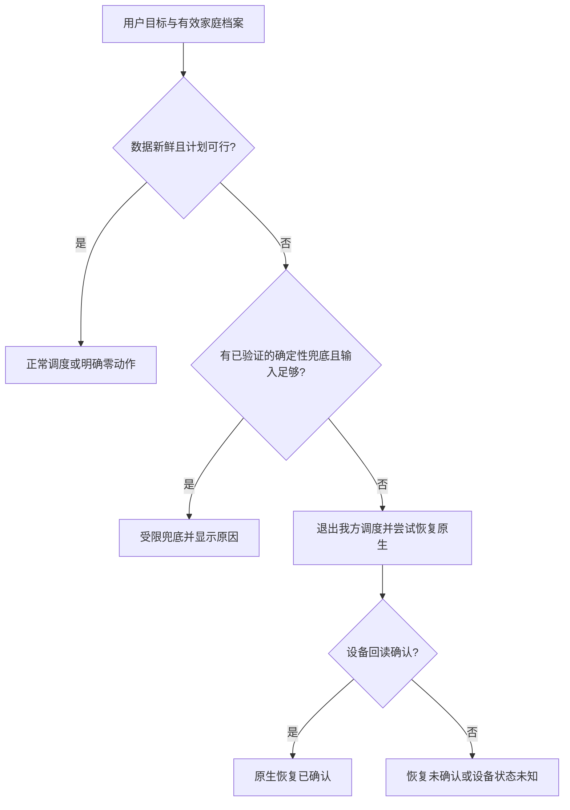

# 德国住宅储能市场深度调研与电小二需求—前端—算法匹配方案

研究日期：2026-10-16（Asia/Shanghai）  
对象：电小二 / SOLIX Autopilot；用途：团队讨论、用户访谈、前端设计与算法研发  
交付状态：本地研究稿；未推送仓库，未修改三仓业务代码，未启动或控制设备。

本文用四类标记区分结论：**【事实】**来自注明时间和口径的材料；**【源码】**指本次选定版本的静态检查；**【推断】**是基于证据的解释；**【建议】**是待团队决定的产品或技术方案。数字算例一律另标**【假设】**，不作为家庭收益或市场成交证据。

## 1. 决策摘要

**建议先服务“已有兼容 SOLIX 储能、可读取完整家庭能流、合同清楚、愿意授权的德国住宅用户”，验证相对其实际可用原生功能的增量价值。当前更缺少的是需求、参数、自动运行和故障状态之间的层次，而不是更多同级档位。**

本次研究的六个重要判断：

1. **德国储能市场足够大，但不能把整个市场当作我们的可服务客户。**住宅、阳台、工商业和大型储能的数量、容量、接入与经济条件不同；固定电价和动态电价家庭也不能共用套利假设。装机增长不能证明软件购买意愿，当前资料不足以给出可靠的全国 SAM 或收入预测。
2. **①是偏好与约束，②③是优化目标，④是自动运行机制，⑥⑦是异常处理与控制归属。**不宜平铺为六个互斥按钮。沿用团队编号，不补造⑤。
3. **“备电”与“保护电池”要分开。**应急保留电量解决停电期间的可用性；磨损、长期高 SOC、低功率效率与动作成本解决使用代价。一个高备用百分比不能自动代表更长寿命。
4. **现有页面的个性化目标主要处于预览层。**当前比赛执行引擎限定 0%～100% SOC、保留量为 0；不能把页面可调 SOC 说成真实家庭可执行的通用约束。算法 `auto/autotune.py` 仍为未实现骨架，页面 `auto` 的两小时负载启发式也不是持续学习或 AI 自动换档。
5. **真实家庭与比赛评分必须保留两套经济契约。**比赛推荐档不计磨损；当前家庭预览请求还显式采用不计磨损的现金口径。因此，“已存在 save 按钮”不等于②③已按真实成本落地。
6. **政策和硬件条件必须成为输入。**德国 MiSpeL 已在 2026 年 10 月形成监管决定，但有实施过渡和批准条件；“设备可网充”“混合来源电量可按某规则结算”“该户已经开通”是不同状态。Max AC 的德国并网功率也不能直接沿用比赛 5kW。[MiSpeL](https://www.bundesnetzagentur.de/SharedDocs/Pressemitteilungen/EN/2026/20261002_mispel.html)、[Max AC 官方页](https://www.ankersolix.com/de/products/a17e2)

**最值得先做的三项工作：**

| 顺序 | 工作包 | 解决的核心问题 | 可交付结果 |
|---|---|---|---|
| 1 | 家庭、合同、计量与设备能力档案 | 用户是否适用、哪些动作合法且可执行 | 有证据来源和有效期的档案；不满足条件时说明具体缺项 |
| 2 | 统一用户目标、经济口径与执行契约 | 页面预览、优化参数、实际控制不是同一回事 | 请求值／有效值／执行值一致；比赛与家庭策略分别验证 |
| 3 | 同条件策略比较与逐户执行账本 | “为什么做、有没有做到、到底省多少” | 预测、实际现金、库存、估算磨损、原生对照和回退原因分列 |

自动换档、结构化记忆及更复杂风险优化随后接入。若前三项没有建立，新增 AI 入口会扩大无法兑现的承诺。

## 2. 现有材料、实现与证据缺口

### 2.1 本次实际查阅范围

| 材料 | 读取情况 | 本文如何使用 |
|---|---|---|
| [德国户用储能市场调研与深度研究报告](https://my.feishu.cn/wiki/QjIOwwRKWibYN2kHKRscy1QOnlb) | 已通过飞书读取；v6.0，2026-09-26，revision 9，正文 32,466 字符 | 作为旧研究底稿；不将原文中的条件假设改成市场事实 |
| [决赛评分逐项评估与深化任务](<20261015_电小二决赛评分逐项评估与深化任务(2).md>) | 已读 | 了解主线、同场验收及未完成事项；不是德国用户访谈 |
| 本地工作包 `07_商业化方案.md`、`04_商业价值与模型实测映射.md` | 已读，版本 2026-10-02 | 保留软件增量与硬件投资分开、同硬件对照及收费假设边界；其中“尚未完整跑通”的旧状态由 10/15 留存报告更新 |
| 后端 `docs/20261015_零动作与功率反馈官方整场验收.md` | 已读 | 作为留存报告证据；本次未重跑、未重新校验全部原始审计链 |
| 前端、后端、算法 | 对关键路径静态核查，版本见下表 | 证明选定代码存在和调用关系，不证明此刻部署或设备状态 |
| 本次德国一手来源 | 联网读取，来源索引见第8节 | 每项保留发布日期、观察期、口径和条件 |

私有飞书正文及读取响应保留在项目 `.local/德国市场研究_20261016/`，未复制进这个公共仓库目录。原 v6 Excel 的存在与先前财务复核记录可定位；**本次未重新打开工作簿或重算全部公式**。

本次检查的是以下本地快照，未拉取远端，不能称为 10/16 远端最新提交：

| 仓库 | 本地分支 | 完整提交 |
|---|---|---|
| frontend | dev | `56fb16a5dd43dca093e781beedad7ab7facfacc4` |
| backend | dev | `7ab6dee34da4b52bca9507fc9162f0f9e6c8439d` |
| algorithm | dev | `6022535a4c974c00138c639bc15be562a91290c8` |
| Anker_camp（研究前） | main | `c859ef6483a090980326c46a46fd19043229074f` |

### 2.2 对旧研究的复核与更新

| 旧报告的判断／数据 | 本次结论 | 对研发的影响 |
|---|---|---|
| 硬件购买价值与软件增量分开 | 保留；两者基线、投资额与决策者不同 | 不在同一“已省金额”里叠加设备收益和软件收益 |
| 工程试点优先已有兼容 SOLIX 用户；安装商业样本可看有屋顶 PV、尚无电池家庭 | 保留这两个不同群体，不能混称首批软件客户 | 招募表明确“已装设备软件试用”或“硬件购买评估” |
| 2025 户储新增约55万套、4.57GWh | 本次读到 P3/RWTH 作者原文，保留其登记数据分析口径 | 不是所有固定式储能，不是今日存量；不能据此算订阅转化 |
| 全部固定式储能约240万套、超过25GWh | 2025年底的 BSW 初步统计仍可作历史基线；2026Q1 已有更新 | 不将大储容量增长写成家庭需求同速增长 |
| 阳台市场需要单独研究 | 新资料补充：其数量与容量份额明显不同，见3.1 | 单独设备档案和收益模型，不套用比赛14kWh/5kW |
| “新屋顶项目约八成配储” | 属旧报告引用的安装商新项目调查，本次未独立重读原调查 | 不能当作全部存量屋顶家庭配储率；新增 KfW 样本口径见3.1 |
| EEG 小型余电上网7.70ct/kWh，旧窗口写8月～次年1月 | 金额在相应新投运类别下可保留；当前监管页窗口为2026-08-01～12-31 | 按投运批次、类别和生效日期绑定，不沿用旧窗口 |
| MiSpeL／混合网充与绿电结算仍有条件 | 10月已有正式决定，不能继续只写“尚在咨询”；也不能写“所有家庭已可用” | 资格与运营方开通状态分开记录 |
| EEG2027 尚未生效 | 当前资料显示9月一读后已有10月5日委员会听证；仍不能按草案改实际结算 | 政策版本与场景分析分离 |
| €3000硬件、1400kWh/年、€60/年软件费等 | 都是旧情景输入；未获得新的家庭报价、账单或支付样本 | 可作敏感性计算，不作当前市场均价或收费验证 |
| 解释、后装接入、自动调度可能有价值 | 保留需求假设；原生厂商和其他 EMS 已有相关供给 | 差异化要证明同设备增量、约束可兑现和低支持负担 |
| “德国用户愿为独立／安心支付” | 不能从调查和非财务效用模型直接推出本产品愿付价格 | 访谈实际权衡，再以明确报价验证；不写全国付费率 |

上述政策更新分别见[当前 EEG 资助页](https://www.bundesnetzagentur.de/DE/Fachthemen/ElektrizitaetundGas/ErneuerbareEnergien/EEG_Foerderung/start.html)、[议会进程](https://www.bundestag.de/dokumente/textarchiv/2026/kw39-de-energie-stromsektor-1211294)。

### 2.3 源码已实现与不能扩大解释的部分

| 能力 | 当前证据 | 还不能声称什么 |
|---|---|---|
| 预测与跨时段优化 | 算法有小时预测、分位输出、DP、终场估值及执行约束入口 | 分位数存在不等于风险优化或逐户在线学习已经通过 |
| 模式与成本 | `recommend` 为比赛目标并移除磨损；`save` 有吞吐成本、门槛及微循环过滤 | 不能把代码注释中的“真省钱最高”“62年寿命”当德国实证 |
| 欧元成本换算 | `config.fx_factor` 已将基础 CNY 成本换成请求 EUR；缺汇率报错 | **不能把已经修好的汇率换算再次列成现存7.9倍错误**；当前磨损标定依据仍需研究 |
| 家庭五档预览 | `home_workspace` 请求 `energy_cash_without_wear`；此口径清除磨损及价差门槛；返回预览标记 | 当前 save 预览不等于真实“含磨损省钱档”；应先决定新契约再修改 |
| 备用目标预览 | 请求0%～小于90%，页面声明有效下限至少30%；返回 requested/effective，明确仅预览 | 30%不是已经证实适合德国所有设备的保护值 |
| 比赛执行 | `scheduled_controller.select_action` 拒绝非0～100%策略或非0保留量 | 个性化备用和上限预览还不能直接进入这一比赛执行器 |
| 自动档 | 算法 autotune 明示未实现；家庭页面按当前负载估计两小时备用量 | 没有读长期记忆、比较候选并自动切换的完整机制 |
| 助手 | `home_answer` 基于当前家庭快照给建议；外部模型可接，本地规则另标；`preview_only` | 没有真实设备自动换档授权链，也未见此路径的持久偏好记忆闭环 |
| 微循环过滤 | 过滤短同向段后，已重算 SOC，并重新限制后续功率 | 不应误报为“滤波后未重算SOC”的现存缺陷；仍需评价经济损失、启动与换向成本 |
| 账本与恢复 | 有统一经济快照、执行状态和完整比赛留存报告 | 一次报告不能代表德国实体电池、任意固件及长期收益 |
| 三语与四页工作台 | 代码已有中英德、总览／计划／账本／比较 | 真实德国用户理解、术语和全部屏幕适配还需任务测试 |

关键实现可直接复读：[家庭预览与助手](https://github.com/solix-autopilot/anker-backend/blob/7ab6dee34da4b52bca9507fc9162f0f9e6c8439d/home_workspace.py)、[比赛执行契约](https://github.com/solix-autopilot/anker-backend/blob/7ab6dee34da4b52bca9507fc9162f0f9e6c8439d/scheduled_controller.py)、[自动调参骨架](https://github.com/solix-autopilot/anker-algorithm/blob/6022535a4c974c00138c639bc15be562a91290c8/core/src/autopilot/modes/auto/autotune.py)。这些是静态入口和界面语义的检查，运行进程环境仍需单独核验；不能据此推断当前设备状态。其余定位见8.2。

### 2.4 当前实际验收应怎样表述

【事实：留存报告】`FLEET-1792095129352485100` 的官方七日 mock 报告记载总增益 **+€2.263865／+2.410477%**；家庭1 **+€6.971728**、家庭2 **+€1.478974**、家庭3 **−€6.186837**，结束恢复及租约释放获记录支持。报告设置为 recommend/P50、SOC0%～100%、5kW模拟上限。

本次仅核读文档，没有重新跑场或复验全部原始 JSON。它支持“已有一场完整执行与恢复证据”，不支持“三户均更省、所有时段准确跟踪、模型独立增益、实体设备或德国商业收益已经验收”。家庭3的负结果仍是执行感知经济优化的重要样本，不能用合计正值遮盖。

### 2.5 尚缺哪些材料

- **没有读到新的德国用户访谈逐字稿、观察记录、拒绝理由或原生应用使用过程。**本报告不把团队设想写成调研结论。
- 缺少真实家庭分时进出电、PV、设备功率、SOC、实际合同账单和安装批次的成套授权数据。
- 缺少具体型号／固件／接线路径的可用容量、部分负载效率、待机功耗、停止时延、看门狗和断网行为实测。
- 缺少新目标群体的全包安装报价、实际软件付款、长期留存及支持工时。
- 旧报告来源较多，本次围绕决策重新核验关键来源，**没有声称其全部参考文献、嵌入表格或其他国家规则已全量复查**。

## 3. 德国市场、用户分群与真实经济条件

### 3.1 普及程度：同时看数量、容量、存量与新增

| 观察对象 | 已核验数据 | 发布／覆盖期与口径 | 可以与不可以推出什么 |
|---|---|---|---|
| 全部固定式电池 | 约240万套、超过25GWh；2025新增约60万套／6.5GWh | BSW 2026-01-12；2025年底初步数，跨住宅、工商与大储 | 表明储能基础广；不能叫240万户用系统。[BSW](https://www.solarwirtschaft.de/2026/01/12/batteriespeicherkapazitaet-binnen-5-jahren-verfuenffacht/) |
| 全部固定式最新季度基线 | 2026Q1新增超过2GWh，同比约+67%；存量约250万套、28GWh | BSW 2026-05-03，登记数据分析；非10月实时盘点 | 大容量增长不等于家庭套数同幅增长。[BSW Q1](https://www.solarwirtschaft.de/2026/05/03/rekordzubau-bei-batteriespeichern/) |
| 住宅储能新增 | 2025约55万套、4.57GWh | P3/RWTH作者2026-06-26原始分析，基于市场登记及分类 | 两数相除约8.3kWh/套，是该新增集合的均值，不能称所有家庭“标准容量”。[作者分析](https://www.pv-magazine.de/2026/06/26/strukturwandel-im-heimspeichermarkt-2025-marktanteile-der-hersteller-zeigen-hohe-dynamik/) |
| 阳台储能 | 上述作者划定≤2kW且≤5kWh；2025占户储新增套数30.6%、容量11.4% | 同一研究的定义，不等于法律中的插接式PV定义 | 小容量市场不可只用GWh判断；登记识别有分类估计，不是逐台审计 |
| 屋顶PV与配储 | KfW样本中18%家庭有屋顶PV，其中55%配电池 | 2026-08-27发布；2025-12～2026-04，4300多户代表性调查 | 可用于观察家庭技术交集；不是安装商新项目配储率，也不是全国已核实可控设备数。[KfW](https://www.kfw.de/%C3%9Cber-die-KfW/Newsroom/Aktuelles/Pressemitteilungen-Details_905088.html) |
| 阳台PV新增 | 2025登记约43万套、0.5GW | BNetzA 2026-01-08；PV新增登记，年底部分估计 | PV数量不是阳台电池数量，不能直接作为储能渗透率分母。[BNetzA](https://www.bundesnetzagentur.de/SharedDocs/Pressemitteilungen/DE/2026/20260108_EEG.html) |
| 租房结构 | 2025年52.8%人口住租赁住宅 | Destatis 2026-04-30，EU-SILC；**人口占比** | 提醒不能只用自有别墅代表德国；不能当作租赁家庭比例或可装电池比例。[Destatis](https://www.destatis.de/Europa/DE/Thema/Bevoelkerung-Arbeit-Soziales/Soziales-Lebensbedingungen/Mieteranteil.html) |

【推断】没有必要用不一致的系统数量相减，制造“尚未安装电池的可服务家庭总数”。正式 SAM 至少要在同一观察时点与家庭口径下交叉设备兼容、能流计量、合同、授权、痛点及支付条件。本次没有这组联合分布，**SAM留空**。

【研究边界】表中较新发布日期不意味着统计覆盖到研究日；没有取得统一、可复核的2026-10-16住宅与阳台储能登记截面。2025和2026Q1不能线性外推全年。

### 3.2 容量、价格、寿命：参数必须对应具体设备

【事实】消费者组织给出的参考为：容量≥5kWh的系统，安装价格约 **€300～700/kWh**，小系统单位价格较高，后装与PV捆绑也不同；其预期寿命参考为 **10～15年**，并提醒高SOC停留、温度和日历老化。约1.5kWh／每1000kWh年用电只是初筛尺度，不是优化结果。[Verbraucherzentrale，2026-07-02](https://www.verbraucherzentrale.de/wissen/energie/erneuerbare-energien/lohnen-sich-batteriespeicher-fuer-photovoltaikanlagen-24589)

【事实：厂商当前展示，2026-10-16读取】德国 Max AC 页列出基础 **7kWh、并网输入／输出3.5kW**；离网端口为3.68kW，营销中的3.5～5kW包含端口组合条件。默认Schuko输出800W、专用回路条件与离网负载路径应分别核对。页面基础机标价€2299、优惠码后€1699；这是当日商品价，不是家庭全包安装报价。其10,000次循环和10年质保是厂商条件性指标，不能推成实际寿命或所有使用成本。[Max AC](https://www.ankersolix.com/de/products/a17e2)

【建议】不要把“7kWh／5kW／95%”固化成德国设备默认值。设备档案至少记录名义与可用容量、并网充放功率、离网端口能力、回路、SOC可读基准、保护边界和固件。功率不是容量；并网能力不是整屋离网能力。当前模拟5kW档案继续留作比赛配置。

【事实】HTW/aquu 的2026研究指出低功率效率、辅助耗电和设备调度能力有显著差异；其厂家质保研究也显示容量保证条件不同。[HTW 2026](https://solar.htw-berlin.de/studien/stromspeicher-inspektion-2026)

【建议】“常见容量”只能帮助招募和初步适配。选型应看夜间负载、PV余电的时段分布、容量利用率和备电需求；有EV／热泵时不能直接用年耗电比例扩容。先调查是否能直接移动负载，避免先把电存一次再给可直接移时的负载使用。

### 3.3 用户不是一种画像

| 群体 | 更可能出现的任务（待访谈确认） | 合格条件及限制 | 优先级建议 |
|---|---|---|---|
| 已有兼容储能＋屋顶PV，固定电价 | 多利用余电、保留所需电量、理解原生为何这样运行 | 相对其实际原生智能功能仍有改善空间；售电机会成本不可忽略 | **工程试点优先之一**，先计算软件改善上限 |
| 已有兼容储能＋动态零售合同＋有效计量 | 在真实总电价下移峰，协调PV、未来负载与备用 | 合同、计费粒度、计量与控制均已可用；不默认允许向网套利 | **工程试点优先之一**，预期决策空间较多但风险也更高 |
| 有EV／热泵的上述家庭 | 离家前充够车、舒适度、热水与并发功率 | 初期先读取计划；直接控制车和热泵需要另外设备适配与授权 | 第二阶段；不因高耗电自动成为高净收益用户 |
| 有屋顶PV、尚未配储的业主 | 判断是否值得购买、容量与安装方案 | 硬件投资、安装商与备用接线是独立决策 | 商业需求访谈样本；不是当前软件控制试用 |
| 阳台PV／小电池、租房或公寓用户 | 易安装、少设置、小容量高利用、租住迁移 | 按具体型号、回路、测量与居住条件验证；Max AC不能代表所有阳台产品 | 独立探索小组，不先扩大控制支持范围 |
| 无PV、动态电价、已有电池 | 纯网充移峰是否值得，避免低效微循环 | 含损耗及新增固定费后仍有机会；网售另判资格 | 小范围影子评估，不能承诺通用套利 |
| 强应急需求家庭 | 指定关键设备、期限和最低保障 | 硬件具备相关离网路径；不能将App保留电量等同整屋备电 | 可作高价值访谈，未实体验证前不承诺续航 |
| 原生已经很好、边际收益很小／高历史售电价家庭 | 少维护、看清账、避免错误接管 | 可能适合只读诊断，甚至不适合付费优化 | 接受“不建议开启／不建议付费”的结果 |

需求的普遍性与假设应分开：KfW观察到，自住一／两户住宅采用至少一种转型技术的比例为59%，租赁公寓为15%；这是**任一种技术**，不是电池持有率。Rabot委托Appinio对1000名30～65岁人员的调查显示，成本与维护担忧值得关注，但其“若能降低账单便考虑购买”的回答不能当真实购买或订阅意愿。未取得完整问卷、权重与微观数据。[KfW](https://www.kfw.de/%C3%9Cber-die-KfW/KfW-Research/KfW-Energiewendebarometer.html)、[Rabot，1月23日报道、9月25日更新](https://www.rabot.energy/magazin/umfrage-zeigt-grosses-potenzial-von-heimspeichern/)

【建议】先按“可接入、已有痛点、原生基线、价值余量、可承担支持成本”选试点。暂缓全品牌电池写入、整屋应急承诺、VPP交易和车热泵自动控制。它们不是无价值，而是当前证据与交付边界不足。

### 3.4 实际经济与市场接入条件

**动态零售合同。**从2025年起供电商须提供动态电价，不能据此推断所有家庭已经签约；监管消费者说明要求相应 iMSys。设备用的CT或Anker Smart Meter不能自动当作法定计费用智能计量系统。产品需要分别标注“合同可选／已签”“计量已安装／正在开通”“价格可读取／实际按此结算”。[BNetzA 动态电价](https://www.bundesnetzagentur.de/DE/Vportal/Energie/Vertragsarten/DynStromtarife/start.html)

**价格成分。**家庭购电价包括采购销售、网络以及税费等组成部分。算法用该户实际边际购电价，不能把批发市场低于零理解为用户充电一定收钱；网络费或税费不能既含在价格里又重复加。固定月费不逐kWh重复摊入短期调度，但新增合同、计量或订阅费用应进入总方案比较。[BNetzA 价格成分](https://www.bundesnetzagentur.de/DE/Vportal/Energie/PreiseAbschlaege/Tarife-table.html)

**售电与投运批次。**当前监管表列示2026-08-01～12-31新投运、建筑≤10kW余电固定报酬为7.70ct/kWh；全额上网、直接营销参考值和旧设备批次不同。不能把这个价格覆盖全部德国家庭，也不能将尚在议会程序中的EEG2027草案作为已生效规则。[EEG 监管表](https://www.bundesnetzagentur.de/DE/Fachthemen/ElektrizitaetundGas/ErneuerbareEnergien/EEG_Foerderung/start.html)

**负电价。**是否减付、何时减付取决于适用法律版本、投运日、装机及计量条件。Clearingstelle的批次解释列出了不同适用情形；本次页面完整表格读取不稳定，未据此生成逐户自动法规判定规则。产品应要求经核对的合同／规则档案，不可统一设置“交易所一负就把全部售电收益设零”。[Clearingstelle 批次说明](https://www.clearingstelle-eeg-kwkg.de/haeufige-rechtsfrage/264)

**§14a。**监管说明中，相关新设备的门槛是并网取电功率**超过4.2kW**，储能看网充方向；互相依赖的组合有专门判断，不能把家庭所有负载随意相加。一台3.5kW并网设备不因“有储能”自动符合这一门槛。符合者的网侧限充信号属于硬约束，相关网络费方案要按实际适用合同处理。[BNetzA 设备范围](https://www.bundesnetzagentur.de/DE/Vportal/Energie/SteuerbareVBE/BetroffeneAnlagen_table.html)

**MiSpeL。**监管新闻正文日期为2026-10-01（URL含1002）。其储能来源分配有精细计算和定额路径；运营实施过渡到2027年9月，过渡期需与有关运营方协商，定额路径还有欧盟国家援助批准条件。因此不能将“决定已发布”写成“本户已可把网充电量按绿电资助售出”。[MiSpeL 决定说明](https://www.bundesnetzagentur.de/SharedDocs/Pressemitteilungen/EN/2026/20261002_mispel.html)

**时间粒度。**欧洲耦合日前市场在2025年10月进入15分钟交易粒度；是否传递给家庭仍由合同决定。我们的真实家庭数据层应保留每条价格的开始、结束、发布时间、时区与计费粒度，不能用整点价格或小时均值伪装成15分钟真值。[EPEX 2025年度结果，2026-01-19](https://www.epexspot.com/en/news/annual-trading-results-2025-overall-record-across-all-market-segments)

以上规则转为产品时，需要的是**有版本的家庭适用条件**，不是把网页概述直接写成对所有家庭生效的执行参数。

### 3.5 竞品对我们的约束：不能把已有供给叫成空白

| 产品／替代方案 | 本次核验到的相关能力 | 价格与边界 | 对电小二的启示 |
|---|---|---|---|
| Anker原生应用与Intelligence | 当前Max AC页已宣传预测／动态电价安排及Anka交互 | 厂商能力介绍不是独立收益证明；本户固件和地区功能须验证 | 对照应为本户真正可用的原生功能，不能只击败弱规则便称软件独有 |
| Tesla Powerwall App | 备用比例可与日常自用／省钱运行共同设置 | 此处仅研究交互，不证明与我们的设备可互换 | 备用是约束维度，不必单独占用一个互斥档位。[官方说明](https://www.tesla.com/de_de/support/energy/powerwall/mobile-app/backup-reserve) |
| 1KOMMA5° Heartbeat AI | 2025-11-14公告向兼容存量系统开放，结合智能计量、连接盒和供电合同 | 当时公告€599硬件、€14.99/月；不是经本次确认的2026成交价或通用兼容报价 | 需要比较总接入与服务成本；不能假定竞争者只服务新装硬件。[原公告](https://1komma5.com/en/press/press-releases/heartbeat-ai-available-for-millions-of-existing-energy-systems/) |
| 保持原生／简单定时／直接移时负载 | 不新增复杂EMS即可完成部分任务 | 效果因家庭而异，没有本产品的订阅及支持成本 | 属于必须保留的低成本基线；“不接管”可以是合理建议 |

【建议】差异化命题收窄为：**在兼容设备和明确家庭边界内，兑现用户目标，解释执行偏差，展示可复核的增量，而不是要求用户每天研究市场或相信一个“AI最优”标签。**这个命题仍需用户使用与对照实验支持。

## 4. 逐项评估档位与建议结构

### 4.1 当前构想不在同一层级

| 团队编号 | 实际性质 | 建议处理 | 当前实现边界 |
|---|---|---|---|
| ① SOC百分比配置 | 用户目标／设备约束参数 | 保留，先澄清最小、最大、备用与时点目标的含义 | 有备用预览；个性化执行未贯通 |
| ② 含磨损、PV效益的综合经济档 | 优化目标＋成本模型 | 保留为真实家庭“净费用优先”；比赛跑分单列 | save有部分成本基础；当前家庭预览不计磨损 |
| ③ 护电池、少动作套利 | 优化目标中的行动代价／风险偏好 | 保留为“温和运行”候选；不是只有固定价差阈值 | 有吞吐成本、门槛和微循环过滤；完整少动作成本及实测缺口仍在 |
| ④ 自动运行方式 | 授权、策略选择与事件调度 | 放在各目标之上的自动托管开关 | 当前自动档不是所描述的完整机制 |
| ⑥ 兜底策略 | 运行异常／能力降级状态 | 后端状态机处理，前端显示原因和范围 | 有比赛原生回退基础，不等于真实家庭兜底已验收 |
| ⑦ 官方原生自发自用 | 控制归属与恢复动作 | 退出我方、恢复尝试、回读确认；也可供用户主动选择 | 有mock终场恢复报告；断网时恢复不可保证 |

### 4.2 ① SOC到底表达什么：先给概念，再定默认值

同一个“30%”可能是四种完全不同的要求：

| 概念 | 用户话语示例 | 对算法的含义 | UI需要避免的歧义 |
|---|---|---|---|
| 硬最低SOC | “不要低于这个保护底线” | 设备及安装方约束；用户不能越过设备允许范围 | 不写成随意可关闭的“AI偏好” |
| 日常备用保留量 | “留一些给停电时的关键设备” | 在硬底线之上，为指定路径保留可用能量 | 明确百分比基准；是总SOC下限还是额外保留，不可重复叠加 |
| 常用最高SOC | “平时不用一直充满” | 日常优化上界；必要时有明确临时例外 | 不是设备最高可充能力，也不保证寿命提升多少 |
| 截止时点目标 | “明天18点前准备到指定电量” | 有期限的目标及可行性／补能成本 | 不把暂时目标永久保存成每天的硬约束 |

【建议】普通界面先展示“日常备用”及其代价，设备保护上／下界放入设备信息或高级设置，时点目标放进用电计划。**这是建议结构，不代表团队已经决定①指其中哪一种。**进入开发前必须在第7节D1作出明确决定。

以同一输入预览备用20%与40%的两套可行计划，展示预计净费用差与可用电量差；不要把“多留20%”机械乘以每天一次循环折算全年损失。若当前SOC低于新目标，应显示“正在达到目标／尚未达到”，不能通过修改显示值伪造已满足。

【假设算例】可用容量7kWh、最低SOC10%、当前SOC30%、离网路径放电效率95%，关键负载300W、辅助耗电20W，则估计交流能量为`7×(30%−10%)×95%=1.33kWh`，约`1.33/0.32=4.16小时`。这是条件计算，未考虑冲击负荷、温度和容量误差，不是Max AC续航保证。没有经过验证的离网路径则不展示“停电可用X小时”。

### 4.3 ② 真实家庭综合经济目标

【建议】将净成本分解为四层，不能都叫“收益”：

```text
实际窗口现金费用 = Σ(电网买入kWh × 实际购价 − 合法售出kWh × 实际售价)
可比窗口价值 = 实际现金费用 − (末库存价值 − 初库存价值)
策略评价成本 = 可比窗口价值 + 估算边际磨损 + 可校准的启动/执行风险成本
家庭购买决策 = 跨年现金流 − 新增服务/计量/安装/设备等成本（避免重复计费）
```

库存价值要说明是否为估算、采用何种后续使用价值；不能默认所有剩电都能按购电价卖出。不同策略比较必须统一终点、初始状态、可用信息与估值规则。真实长期评价还应检查滚动视野是否形成无意义的终点充放电。

PV电量不是无条件免费。对“原本可以上网、现在先存再用”的一单位有效输出，简化边际价值为`未来避免购电价 − 原可得售电价/往返效率 − 额外成本`；对本来会弃掉的PV，应改用实际边际机会成本。电网充入的电不能记成新增光伏自用；已有PV建设成本通常不是这一次储存动作的新增成本，但属于硬件投资模型。

**需要补齐的具体参数：**进出电实际结算价格、来源可追踪性、设备效率／待机、容量、用户边界、磨损依据、可执行性成本。暂不可信的磨损参数显示区间和敏感性，不伪装成电池健康测量。

**当前代码有基础，也有需要先纠正的解释。**`save` 的0.31是基础CNY吞吐成本，请求EUR后约为€0.03924/kWh，汇率已经换算。`step_money`按`|power|×dt`给充、放两侧计费，而标定注释以购买价除单次可放电量和循环次数估算。若原参数意图是“每输出kWh的替换成本”，在两侧使用可能与该口径不一致；若意图是“双侧吞吐边际成本”，则分母和实测校准应对应双侧。**这是成本定义与标定待审计项，不在本研究中直接改数或机械除二。**此外，名义循环数÷日循环次数得到的“62年寿命”忽略日历老化，不能进入前端承诺。

### 4.4 ③ 怎样定义“值得行动”

【建议】门槛应从净价值产生。以向家庭供出的1kWh为单位，纯网充移峰的简化条件：

```text
M = p_high − p_low / η_rt − c_wear,out − c_aux,out − c_risk,out
候选段值得做：E_out × M > K_start + K_direction + K_other + 最小净收益裕量
```

`p_high`是实际避免的边际购电价；向网售电时应换成该户合法可得的售电净价。效率随功率、温度和持续时间可能改变，辅助成本不能和效率损失重复计算。`K`按每段／每次计，不能混成每kWh系数。

【假设算例；不是实测】同样买€0.25、避购€0.35，假设每有效输出kWh磨损€0.04、额外辅助€0.005，未计启动费：

| 往返效率 | 单位净边际值 | 解释 |
|---|---|---|
| 90% | `0.35−0.25/0.90−0.04−0.005=+€0.02722/kWh` | 仍需足够电量覆盖固定动作代价 |
| 75% | `0.35−0.25/0.75−0.04−0.005=−€0.02833/kWh` | 同样10ct价差也不值得行动 |

若第一行另有每段€0.05的假设启动成本，至少约1.84kWh有效输出才抵平该项；这不是建议产品门槛，只说明**价差、功率、持续时间与可用能量一起决定结果**。固定购价下的纯网充再自用，在有损耗且无其他价值时不会创造套利收益；PV移时、限发、备用和网费机制应另算。

③应评估：最小净收益、最小连续动作时长、换向冷却、功率死区、待机耗电、执行延迟、累计吞吐与峰值功率。少发HTTP请求不等于减少电池循环；少做动作也可能错过大额收益。因此采用“净费用—吞吐—动作段数—最差情景”对比，再给用户“温和运行”的具体含义。

参数不能从行业报告凭空定成“价差>10ct”“冷却30分钟”。用本机测量和历史回放识别合理范围，在留出数据上锁定测试；以结果决定默认值。

### 4.5 ④ 自动运行：目标不漂移，参数可以有界调整

【建议】自动运行不意味着AI每天替用户改变人生偏好。需要区分：

- **目标层：**省钱、少动作、备用期限，来自用户及其明确授权。
- **参数层：**在用户允许范围内调整充电窗口、保留目标、候选策略，留下理由与有效期。
- **动作层：**实际功率与设备模式，由确定性执行器检查后提交，不由语言模型自由输出。

职责建议如下：

| 模块 | 负责 | 不越过的边界 |
|---|---|---|
| 大模型／电小二 | 解析用电安排、发现歧义、形成结构化候选、解释现有证据 | 不编造家庭事实，不直接写功率，不自行提升控制权限 |
| 预测模型 | 只用当时可用历史及天气预测负荷／PV，输出不确定性与数据状态 | 不读取未来真值；小时模型不能冒称15分钟实测精度 |
| 优化器 | 在相同家庭约束下比较候选并给功率计划、代价和不可行原因 | 不把非法售电、无离网能力或过期价格当机会 |
| 后端策略管理器 | 检查授权、候选资格、收益裕量、切换成本和冷却；管理版本 | 不因一句聊天文本立即切换执行配置 |
| 确定性执行器 | 按设备能力映射、处理租约、限幅、确认、超时与恢复 | 不把接受请求等同实际执行，不覆盖其他合法控制者 |
| 前端 | 显示用户选择、有效目标、执行状态及撤销入口 | 不用“已开启”描述仅预览或排队状态 |

切换逻辑先做可解释的小候选集合。只有候选可行、数据新鲜、授权覆盖且保守净收益改善超过切换代价与裕量时才切换；必要时以风险／备用需求触发，明确说明优先级。具体评价窗、冷却期和阈值由回放及用户研究校准，不能把建议写成已验证常数。

用户应可查看最近一次调整、原因、影响、截止时间并覆盖；覆盖是否暂停自动调整、暂停到何时要明确。紧急保护及设备硬限制不因人工操作而失效。设置恢复默认是新的版本，支持撤回未来安排，不能“撤销”已经消耗的电量。

### 4.6 备忘录：运行日志先做好，再逐步形成可编辑记忆

【建议】先建事件记录，不先建万能长期记忆。最小字段：

| 字段组 | 建议字段与含义 |
|---|---|
| 身份与关联 | 去标识化家庭ID、事件ID、计划／决策／执行／账本ID、设备与策略版本 |
| 时间与可用性 | 发生时间、观察时间、写入时间、UTC、Europe/Berlin偏移、有效起止、数据截止时间 |
| 内容类别 | `explicit_preference`用户明确偏好；`observation`观测事实；`model_explanation`模型解释；`hypothesis`待验证推断 |
| 来源与状态 | 原始证据引用、来源质量、提出者、是否已确认、替代了哪个版本、撤销／到期状态 |
| 用户边界 | 目标、授权范围、允许自动调整区间、事件截止、可编辑或删除入口 |
| 计划与结果 | 请求参数、有效约束、预期动作、实际动作、反馈差异、费用口径、回退／恢复状态 |

“家庭周二较少用电”是推断；“用户确认周二不在家”才是明确偏好。模型对亏损的解释不是因果证据，后续实验支持后也要记录范围与反例。单次噪声、断连或设备故障不能永久记成用户习惯。

读取记忆时按家庭、时间、状态和授权过滤；过期或冲突的安排应要求澄清。家庭切换、多人修改、旧提案延迟到达都要失效旧版本。可访问的日志不等于自动获准上传云端，试点需另定最小数据、保留期、删除和访问范围；不把凭据放入备忘录。

### 4.7 ⑥⑦ 兜底与原生恢复：必须表示“未知”

【建议】区分正常零动作、预测不可用、策略不可行、控制失败和通信不可达：



兜底不能依赖与主策略同样已经失效的数据。例如模型调用失败但SOC／能流新鲜，可使用经过验证、受限的确定性规则；SOC和通信都不可用时，不能继续假定安全执行。若没有适用规则，直接尝试退出，不必为了“层级完整”硬造一档。

| 情况 | 行为建议 | 前端状态与证据 |
|---|---|---|
| 优化器选择0功率 | 保持约定的有效零动作语义 | 正常待机；不能自动解释成原生策略 |
| 预测失败，采集正常 | 保存采集；评估合格的受限兜底 | 预测不可用、执行来自哪条规则 |
| 备用目标当前不可达 | 告知缺口与代价，按明确恢复／补能规则处理 | 请求目标、当前值、预计达到时间及不可行原因 |
| 命令拒绝／反馈偏差 | 有界重试、退出或降级；保留原事件 | 已提交／待确认／失败分别显示 |
| 通信断开 | 不承诺远程恢复成功；依据已验证的本地超时行为处理 | 最近确认时间、状态未知、可执行的用户处理步骤 |
| 恢复请求成功但未回读 | 继续有界核验，超限保留未确认 | 不显示“已恢复” |
| 恢复模式且租约释放有证据 | 标记恢复确认 | 模式、确认时间、租约及来源；不据此保证未来不再变化 |

设备侧看门狗、租约超时与断网默认行为应单独实测。原生自发自用既可以是故障后的控制归属，也可以是用户主动选项；不需要把它包装成“最差一档”。

### 4.8 建议的产品结构与核心功能（供讨论，未实施）

建议普通用户看到两个主要运行目标：“**净费用优先**”“**温和运行**”；有访谈证据后再判断是否需要第三个“优先使用自家太阳能”。备用设置独立，自动运行开关独立，“使用设备原生管理”作为清晰退出选项。不要为了对称硬凑三档。

五项核心功能可以串成一个使用过程：

1. **家庭适配档案：**接设备、核对合同和计量，告诉用户能做什么、缺什么。
2. **目标与取舍预览：**选目标、设备用；同条件看费用、可用电量、动作代价的变化。
3. **用电计划与自动管家：**记录未来安排，确认范围后有界调整，并能覆盖／撤销。
4. **执行与能源账本：**看计划是否兑现、实际进出电和窗口结果，区分预测与已结算。
5. **运行备忘录：**查看事件与偏好来源，编辑明确偏好，追溯AI为什么提出建议。

这套结构保留现有四页的主线，不必新增五个一级菜单。目标是一次设置后少操作，同时在异常和有争议的决策上保留控制权。

## 5. 需求—前端—算法—后端映射

### 5.1 核心映射表

“需求证据”中明确区分公开研究、具体设备要求与待访谈假设。以下验收指标是建议测量项；除明示项外，不代表当前已经通过。

| 用户群体 | 需求证据 | 使用场景 | 用户需要作出的选择 | 前端展示与交互 | 算法目标和约束 | 所需数据 | 后端执行要求 | 验收指标 | 当前实现状态 |
|---|---|---|---|---|---|---|---|---|---|
| 兼容储能＋屋顶PV，固定电价 | 3.1存量与配储事实；具体不满待访谈 | 夏日余电、夜间用电 | 自用／经济取舍，备用与是否授权 | 余电去向、原生对照、调高备用的机会成本 | 购售电机会成本、损耗、PV来源、相同终端估值 | 分时负荷、PV、能流、合同售价、原生能力 | 同快照规划，来源分账，不能将网充计作PV | 同约束净成本差、额外PV自用、覆盖率 | 有预测、规划和预览；真实合同及分来源账本待补 |
| 动态电价且有效计量家庭 | BNetzA合同／计量条件；节省量待实测 | 低价网充、高价避购 | 是否允许网充，愿承担多少波动，备用边界 | 到手买卖价、区间、最差情景；缺条件时禁用相应动作 | 完整边际价、效率、磨损、网侧限充；网售资格另判 | 合同、iMSys状态、价格发布时间、设备曲线 | 合同／规则版本，价格完整性，越界拒绝 | 扣全部新增成本的窗口增量、负增益比例、风险尾部 | EUR及官方价格可用；真实零售适配尚未验证 |
| 对电池使用代价敏感者 | 消费者组织老化提醒；Rabot维护担忧，见3.2／3.3 | 不想为微利频繁运行 | 愿牺牲多少节省来少吞吐／少动作 | 经济与温和方案并列、费用差、吞吐与动作段数 | 净收益门槛＋启动换向成本＋最小时长；硬边界不变 | 部分负载效率、待机、执行时延、磨损区间 | 按段执行与冷却，监测实际而非仅命令次数 | 实际净成本、吞吐、等效循环、换向、空耗 | 有过滤和成本参数；家庭预览未纳入磨损，整体待验证 |
| 有关键负载备用需求者 | 设备离网能力及Tesla备用交互；偏好强度待访谈 | 临时天气风险、关键设备保障 | 要保护哪些负载、何时、容忍什么风险 | 百分比＋可用kWh；具备路径后才估时长，显示未达目标 | 时点能量目标、关键负载功率、设备上下限、补能代价 | 可用容量、关键负载、离网接线、效率和事件期限 | 原子配置、达标进度、冲突拒绝、实际读回 | 目标满足率、不可达解释、经批准的实体供电测试 | 有预览；无德国实体备电保证；比赛引擎不支持任意备用 |
| 有未来用电安排的家庭 | 团队需求假设，尚无行为访谈 | 出行、聚会、居家办公、EV出发 | 安排是否只是提醒、是否允许调整，截止目标 | 日历／计划条目、预计成本、确认与撤销 | 将确定安排转为负荷情景或约束，避免重复计入预测 | 时间、设备、能量／功率、确定性、来源、有效期 | 版本和时区，冲突检测，过期不执行 | 解析正确率、冲突处理、用户覆盖及误触发 | 助手可提预览；日程化自动执行待做 |
| 希望少操作但保留控制权者 | 待真实用户验证；竞品已提供自动能力 | 长期自动管理、异常时介入 | 自动权限边界、通知与覆盖期限 | 自动托管状态、最近调整原因、暂停／恢复 | 候选策略同条件评价，切换裕量与冷却 | 授权、偏好版本、预测、执行质量 | 策略管理器隔离LLM与执行器，防旧提案 | 越权0、旧版本拒绝、切换净价值、恢复可查 | 自动调参骨架未实现；现为预览建议 |
| 所有试点家庭 | 项目已有反馈偏差、回退和逐户负收益案例 | 页面说省钱但用户账单不同 | 查看窗口、基线与证据；是否继续接管 | 预测／实际／结算分栏，逐户解释差异 | 可执行约束、统一终点与库存，误差分解 | 实际区间能量、计划、反馈、现金、原生基线 | `/api/dashboard`等输入标准化，账本核对，错误隔离 | 对账误差、有效控制时长、执行能量误差 | 已有经济快照、执行状态与一场mock报告；真实账单未验证 |
| 通信／预测／设备异常家庭 | 已发生工程问题；官方集成有前提 | 断网、过期计划、固件变化 | 是否主动退出；是否需要现场处理 | 降级原因、最后确认时间、恢复已确认／未知 | 仅对新鲜且可行数据生成受限计划 | 故障类别、租约、最近读回、设备看门狗 | 有界重试、幂等、退出、回读、保留缺口 | 故障覆盖、恢复确认时间、未知状态正确显示 | mock回退与终场恢复有报告；实体断网待测 |
| 阳台小储能或租房家庭 | P3分类、Destatis居住结构；产品需求待访谈 | 小容量余电利用、搬家或受限回路 | 是否有可安装路径、是否值得接入 | 简洁适配问卷、小容量收益区间、明确不支持项 | 独立容量功率档案、基础负荷、防逆流条件 | 型号固件、回路、PV、整户测量、合同 | 新适配器必须独立验证；不复用三户ID策略 | 接入成本、合格率、数据完整性、净增量 | 当前没有可泛化到全部阳台产品的验收 |

### 5.2 前端落位：保留四页，补齐贯穿各页的语义

| 页面／位置 | 建议保留与新增 | 用户应该能完成的任务 |
|---|---|---|
| 首次接入／设置 | 家庭档案、合同与计量向导、设备能力与数据授权；少填未知项但显式标注未知 | 知道能否使用哪些能力，而不是先看到不可执行的档位 |
| 总览 | 家庭实际状态、设备时间与数据新鲜度；当前目标、执行归属、最近一次调整；费用口径标签 | 看懂“当前在做什么，谁在控制，是否需要处理” |
| 能源计划 | 时间轴、价格／PV／负荷及不确定性、未来安排、备用进度、预计动作与不可行原因 | 添加或撤销计划，理解接下来为什么充／放／等待 |
| 策略比较 | 同快照、同设备、同备用的经济／温和比较；把不同备用条件的比较明确另列 | 选择目标，看清预计费用与使用代价；不把预测当实绩 |
| 能源账本 | 购电支出、售电收入、净现金、初末库存调整、结算／估算磨损／服务费；执行偏差及缺口 | 核对特定窗口结果，解释“预计好但实际差”的原因 |
| 助手与备忘录 | 提案→预览→授权范围回显；事件历史、偏好来源与有效期、恢复记录 | 编辑偏好，知道AI建议基于哪些事实，能拒绝与撤销 |

样式上沿用现有主色调与空间布局，无需为了本报告先重做视觉系统。德国本地化重点是术语、信息与状态：`kW`和`kWh`不混用；`ct/kWh`与`€/kWh`清楚；金额、逗号小数与日期统一；`Reserve`表示备用，避免以`Batterieschutz`暗指已证实延寿；“Vorschau／Ausführung／Abrechnung”分别表达预览、执行与结算。德语长标签、移动端、键盘和屏幕阅读器需要真实测试，不仅检查翻译键是否存在。

**减少选择不等于隐藏控制权。**默认展示一个当前目标和一个调整入口；详情中保留实际约束、原生退出和证据。日常正常运行不必推送每次功率变化，只在影响目标、异常、授权变化或约定结算时通知。

### 5.3 数据与接口契约：复用 `/api/dashboard`，不把它当万能结果

【源码】`official_economics.snapshot`已读取 `/api/dashboard`，从同响应校验遥测、基线、现金和库存结算；`home_workspace`再形成家庭工作台，并有 `device_execution`、数据质量及预览标记。本次没有调用现场接口，因此不宣称其当前在线。

**已有路径值得保留：**同快照的经济输入、固定比赛终点、采集与预测失败隔离、源日期验证、实际状态接口。不要因面向德国用户便重写已完成主线。

**真实家庭适配还需补的字段，以下均为建议，不代表接口已经提供：**

| 字段组 | 关键内容 |
|---|---|
| `household_profile` | 家庭时区、责任人、PV／负载类型、原生能力、设备型号固件、版本与核验来源 |
| `tariff_profile` | 固定／动态、含税边际购价、售电类别、投运批次、固定新增费用、计费粒度、来源与有效期 |
| `eligibility` | 网充、网售、来源混合、计量开通、网络限制、离网路径分别以已核验／不满足／未知表达 |
| `goal`／`policy` | 用户请求、设备硬边界、系统有效约束、当前执行版本及生效时间分别返回 |
| `forecast` | 区间开始／结束、发布时间、原始粒度、预测分位、转换方法、覆盖与缺口 |
| `execution` | 归属／租约、期望动作、映射目标、接受与实际反馈、偏差、回退、恢复确认 |
| `accounting` | 预测／实测／官方结算来源、现金、库存、估算成本、基线、对照可比性及窗口 |
| `memo`／`permissions` | 事件类型、证据引用、有效期、确认状态、可执行权限与覆盖期限 |

保留输入与输出的单位、币种、来源时间和版本。面向德国需另建真实时钟与合同适配器；当前 `price_day` 明确要求一天24个小时价格，不能简单放宽校验便声称已支持德国15分钟计费、夏令时或所有动态合同。

## 6. 开发优先级、依赖与验证计划

### 6.1 研发任务顺序

P0代表防止方向与承诺错误的基础，P1为基础通过后的候选，P2为扩大支持范围；不是未经团队确认的排期或工期承诺。

| 优先级／任务 | 前端 | 算法 | 后端 | 依赖与完成标准 |
|---|---|---|---|---|
| **P0-1 家庭适配档案** | 设备、合同、计量、备用路径和授权向导；未知项解释 | 按能力筛选动作，不能默认网售 | 有来源与有效期的档案；单户隔离、配置版本 | 选定试点型号／固件；能区分固定价、动态未开通、动态已开通、无离网、无网售五类条件 |
| **P0-2 目标与执行契约** | ①含义确定后显示请求／有效／执行值，区分预览 | 家庭目标与比赛目标分离，统一上下界及不可行反馈 | 独立家庭策略配置，端到端校验与回读；保留比赛契约 | P0-1及D1决定；个性化边界在预览、重规划、命令和恢复全过程一致，无静默放宽 |
| **P0-3 逐户账本与比较** | 现金、库存、预计／实际、缺口、对照清楚 | 同信息、同约束、统一终点比较；执行风险回放 | 复用经济快照，接区间能量与执行审计；模式归因无证据时留空 | 可对账数据；逐户和合计均能复核，家庭3负结果保留 |
| **P1-1 经济与温和候选** | 明确目标取舍，不宣称延寿年数 | 审计磨损单位，校准效率／空耗／启动换向成本；修正只按次数评价 | 实测时延、候选段执行、实际吞吐汇总 | P0-2／3及参数数据；留出窗报告费用、负增益、吞吐、动作段数与风险 |
| **P1-2 结构化备忘录与计划** | 事件、偏好、解释分开；有效期及撤销 | 消费经确认安排，避免与预测重复计量 | 事件持久化、来源、冲突、幂等及跨家庭隔离 | P0-1；重启后偏好可恢复，过期／撤销／旧版本不被执行 |
| **P1-3 有界自动运行** | 自动权限范围、最近切换与暂停／覆盖 | 同条件候选评价、置信与切换成本、冷却 | 计划管理器＋确定性执行器，提案不能直接变功率 | P1-1／2；越权／错误记忆／模型失联时确定性测试通过，净收益贡献另测 |
| **P1-4 德语任务验证** | 真用户执行设置、解释、撤销、故障处理 | 给出正确且可理解的不可行原因 | 错误码可映射到本地化动作，不输出认证信息 | 核心流程定稿；记录误解与完成情况，修复高影响理解错误 |
| **P2 多设备与商业验证** | 新型号／阳台／车热泵支持范围 | 多资产优化与更广季节验证 | 新适配器、法规和合同覆盖、支持与部署 | 一套配置稳定可交付后再扩展；不以现有三户ID作为家庭分类器 |

**当前最关键的依赖冲突：**页面预览至少30%保护、比赛执行0%～100%、未来家庭自定义三者不能靠改一个常量统一。应明确策略配置的适用场景与版本，在各层传递同一契约；现有比赛成功配置保持可复现。

### 6.2 比赛前与赛后分别做什么

| 范围 | 比赛前值得完成 | 赛后真实德国用户需补 |
|---|---|---|
| 产品表达 | 修正档位与预览／执行描述，清楚展示当前实际能力；完成一套目标与证据流程 | 真实目标排序、备电语义、自动权限和价值感知访谈 |
| 适配 | 做可展示的家庭档案和资格状态；比赛设备与德国产品档案分开 | 型号、固件、安装回路、iMSys与零售合同逐户核验 |
| 算法 | 复用固定终点、经济快照、真实执行周期回放；解释第三户损失；做小规模机制消融 | 部分负载／待机／日历与循环磨损校准；多季节、合同及未见家庭验证 |
| 执行 | 在授权mock范围验证契约、错误状态与恢复；不将未通过的个性化执行展示成已开启 | 真实家庭另行授权，实体中断／恢复、保护及安装条件测试 |
| 经济与商业 | 逐户完整结果、负结果、预测与结算边界；明确€60年费仅是假设 | 实际增量、支持工时、报价与付款、退款／持续使用、年度留存 |

如果赛前时间不足，优先把“读真实状态—设目标预览—解释计划—查看执行与结果”做正确；自动换档可展示明确标注的影子候选，不应为了路演提前接通未经验证的设备控制。

### 6.3 评价指标与对照方法

| 层面 | 建议指标 | 解释边界 |
|---|---|---|
| 家庭价值 | 每户窗口净现金、可比库存调整后价值、原生增量、含估算磨损及新增费用的敏感性 | 实际现金与估算成本分别列，不把硬件原有收益算软件贡献 |
| 不利结果 | 负增益家庭／窗口比例、较差情景损失、备用未达与不可行次数 | 合计为正不能遮住单户损失；小样本分位不作稳定总体分布 |
| 执行 | 有效控制覆盖时长、实际区间能量误差、目标兑现、接管等待、回退与恢复时间 | 单帧功率匹配率不等于连续能量跟踪；确认次数不能除以命令数充当覆盖率 |
| 电池使用 | 充／放吞吐、明确口径的等效循环、换向与有效动作段数、低效小功率耗电 | 只计指令次数不能说明寿命；SOC估计不是健康度测量 |
| 预测 | 负荷／PV分开误差、分位覆盖、不同预测来源及发布时间、经济贡献 | MAE下降不自动带来省钱；小时区间校准不能冒称15分钟真值验证 |
| 用户体验 | 能否说清目标／执行／收益差别，设置及撤销完成率，误解类型，异常处理成功 | 首批定性样本不报告德国总体比例 |
| 交付成本 | 接入时间、支持工时、云费用、故障频次、版本迁移成本 | 不以免费人工为零成本，也不将短试点直接外推年度成本 |

对照至少保留：本户可用原生策略、简单规则、当前统一策略与新候选。比较时统一初始SOC、外生负载／PV、合同、用户边界、数据发布时间和期末估值。不能事后给每户挑胜者再称为在线自动选择。

真实电池不能同时运行两种策略。相邻时段的交替实跑受天气和行为影响；同输入反事实回放受模型误差影响，两种证据分别报告。先用影子计划和理想信息上界判断是否有足够价值空间，再决定是否值得扩大算法复杂度。

### 6.4 必须覆盖的验证情景

| 情景 | 重点检查 |
|---|---|
| 固定价、无显著PV余量 | 不因交易所低价擅自网充；允许结果为“不值得接管” |
| 高历史售电报酬 | PV存入机会成本可能高，不能统一用7.70ct |
| 动态合同但iMSys未开通 | 展示缺项，不能承诺按动态价实际结算 |
| 动态已开通但网售不具资格 | 可以评估网充避购；禁止把网售利润算进去 |
| 混合来源及MiSpeL过渡期 | 来源、资格、运营开通分别验证；待批准项不作为既成收益 |
| 晴天大余电、阴天、低负荷与冬季 | 预留空间、效率和空耗；不能只验证一个晴天 |
| 上调备用时SOC已低于目标 | 处理达标过程，不伪造立即满足或悄悄下调用户目标 |
| SOC上／下边界、功率端口不同 | 比赛5kW与德国并网3.5kW等档案互不覆盖 |
| Europe/Berlin夏令时切换 | 23／25小时、92／100个15分钟区间及重复本地时刻正确，UTC唯一；普通日96点 |
| 价格／历史未到可用时间、缺点 | 无未来泄漏，不跨日nearest匹配，不把小时复制称15分钟真值 |
| 断连、计划过期、模型故障、反馈偏差 | 采集独立、动作有界、未知状态可见、恢复要确认 |
| 多人修改、家庭切换、旧助手提案 | 乐观版本检查、家庭隔离，过期授权及旧提案拒绝 |

### 6.5 保留旧经济模型，但改变它的用途

【假设复算】旧情景 `p_buy=€0.32`、`p_sell=€0.08`、`η=0.90` 时，每额外有效PV自用kWh的简化价值为 **€0.231111**。若仅抵消€60年费，需要 **259.62kWh/年额外有效自用**；还未覆盖其他新增成本。它不是“储能总年自用量”，也不是动态价套利门槛。

因此第一步可以测：同设备、同用户约束下，相对真实原生，是否还有这个量级的潜在改善？若理想信息上界都不足，不应靠更大模型许诺解决。若用户为解释或运维付费，应作为独立购买理由验证，而不是把它伪装为能源节省。

旧硬件投资情景的NPV、支持成本和留存假设仍能用于压力讨论；当前商品优惠价变化不代表全包安装总额、维护成本或软件收益已改变。此次不重写财务模型，不给出未经报价与用户数据支持的收费结论。

## 7. 下一轮讨论决定与用户调研

### 7.1 团队需要作出的具体决定

| 编号 | 已知／未知与影响 | 可选方案及取舍 | 建议如何解决／下一轮决定 |
|---|---|---|---|
| D1 ①中的百分比是什么 | 团队语义未定；直接影响UI、可行域与恢复 | 备用下限易理解但不覆盖所有需求；上下界更全面却增加复杂度；时点目标适合临时安排 | 先看用户实际表述；团队确认MVP的参数名称、基准和谁能修改，不擅自替用户决定 |
| D2 首批用户与型号 | 有工程基础，没有当地试点名单及硬件测量 | 已装兼容设备可测软件增量；无电池业主可研究硬件购买但不能直接控制试用 | 明确一套型号／固件／回路与招募条件，固定／动态合同分别招募 |
| D3 用户主要购买理由 | 省钱、寿命、备电与解释的排序未知 | 单押省钱便于量化但空间可能小；组合价值更广但难归因 | 用最近一次真实困扰和行为取舍访谈，不先展示档位诱导 |
| D4 真实经济成本口径 | FX已实现；吞吐标定、空耗、日历磨损仍不足 | 单一系数简单但不确定；实测曲线更准但成本高 | 先统一€/输入、€/输出或€/双侧吞吐定义，做敏感性；无证据不宣称寿命提升 |
| D5 目标结构 | 现有五档有语义混合和预览限制 | 两目标＋独立备用更清楚；保留五档迁移少但继续混淆 | 选择对用户可解释的结构，旧内部key可暂兼容但不混称已经自动化 |
| D6 自动权限 | 用户愿交多少控制权未知 | 仅建议安全且易验收；有界自动更省操作但需授权、版本和恢复 | 分别讨论调参、切换策略、网充、提高备用的权限；确定覆盖和到期规则 |
| D7 备忘录边界 | 目前是日志设想，不是已验证记忆 | 事件记录易追溯；长期推断更便利但有污染／冲突风险 | 先定四类记录、有效期与用户编辑权；再试记忆检索，不先做自主学习 |
| D8 原生恢复与兜底 | mock有恢复证据，实体断网行为未知 | 模型失败用受限规则；若关键状态未知则退出／提示现场处理 | 选型号实测看门狗、租约和回读；定义何时显示未知，兜底不强求独立档位 |
| D9 价值对照与商业费额 | 一场比赛总体正、第三户负；€60为旧假设 | 与基础自用比容易，但可能夸大对原生智能的增量 | 确认每户原生可用功能；定逐户评价和退出条件，收费等明确服务后再测 |
| D10 德国规则与合同维护 | 政策存在过渡、价格批次差异 | 全自动法规判断复杂；经核对模板支持面窄但可交付 | 先做少量经核验合同模板；明确谁更新、何时复核及未知时禁用什么 |

### 7.2 下一轮最小调研设计

【建议，尚未执行】先做约12户探索性访谈，不作为统计代表性调查：

- 6户已有兼容或可核对储能的家庭，尽量覆盖固定／动态合同及不同PV供需；记录原生功能差异。
- 3户有屋顶PV、尚无电池，验证购买障碍、安装决策与成本口径。
- 3户阳台小储能、租住或有EV／热泵的特殊场景，发现我们首批范围未覆盖的任务；不要把多种差异合并成一个“普通德国用户”。

人数可依招募调整。高技术熟练度家庭较易接入，但会造成样本偏差；需记录技术熟练度、设备管理者与电费承担者是否同一人。没有实际匹配对象时不为凑数将不合格家庭纳入控制试用。

访谈后可从合格家庭中选3～5户做6～8周工程试点：先只读／影子计划，数据满足后在另行授权范围有限控制。它不能证明全年收益、长期寿命或续费率；冬夏需要另补样本。

### 7.3 非诱导访谈提纲

**先问生活与现有行为，最后才展示方案。**不要开头问“您是不是需要AI帮您切档省钱”。

1. 最近一周，您什么时候查看过电池或能源App？当时要解决什么？请带我们走一遍。
2. 最近一次手动改变设置是什么？为什么改，后来怎么看有没有达到目的？如果没改过，是什么让您不需要或不愿意改？
3. 您怎样知道电池给家庭带来了多少价值？现在看哪个账单或数字？哪些数字您不相信或看不懂？
4. 原生功能中，哪一个最有用？最近一次让您不满意的具体情况是什么？当时采取了什么办法、花了多少时间或钱？
5. 您实际是什么购电与售电合同？能否在本人同意下展示隐藏身份信息后的价格条款？合同、App显示与账单是否一致？
6. 您是否因为储能改变过用电安排？例如做饭、洗衣、车、热水或外出。哪些事情不能调整？
7. 如果停电，真正要维持的设备和时间是什么？目前是怎样接线的？您是否实际测试过，而不是只在App里设过备用？
8. 您怎么理解“保留30%”？认为这30%什么时候可以用、能支持什么？先记录原始理解，再解释不同含义。
9. 您对电池变旧有什么担心？这种担心来自经历、保修条款、别人建议还是直觉？您已经因此改变过什么？
10. 在具体且对称的两个方案里，例如费用较低但吞吐较多、费用稍高但较少动作，您怎样选？说不清时允许不选；不暗示哪种更理性。
11. 哪些调整您愿意提前授权？哪些必须每次确认？如果系统判断与您不同，您希望怎样查看、暂停或恢复？
12. 一次建议没有省钱或数据断开时，您希望系统怎么做？什么时候需要通知，什么频率会让您关闭通知？
13. 您愿意让系统保存哪些记录、保存多久？有哪些记录不希望上传或被其他家庭成员看到？
14. 您以前为能源软件／安装支持付过什么费用？这次要达到什么具体结果，才会考虑付款？先询问实际经历，再展示明确服务范围的价格。
15. 看完原型后，请自己完成“设定明晚目标—查看预计代价—找到是否执行—撤销安排”。哪里停住或理解不一致？不要由访谈者代操作。

可供德语访谈人员调整的开场例句：*„Erzählen Sie bitte vom letzten Mal, als Sie eine Einstellung Ihres Speichers geändert haben.“*（请讲讲上次改储能设置的经历。）这里只提供语义草案，未经过德国用户语言测试。

### 7.4 每次访谈需要留下什么

每户保留匿名编号、条件、原生功能、原话与实际操作、最近发生的具体问题、现用替代方案、明确权衡、权限边界及后续验证事项。分别标“说过”“展示过”“实际完成”“付款”，不互相替代。结论应带反例：不想自动化、原生已足够、缺乏收益空间、拒绝分享数据的家庭也属于有效发现。

优先要验证的五个假设：

| 假设 | 支持它需要什么 | 什么结果会使我们调整方向 |
|---|---|---|
| 用户不愿频繁操作，但愿提前授权 | 原有频繁维护行为＋在明确权限下完成自动托管任务 | 大多数痛点来自接入／账单而非调度，或明确拒绝自动控制 |
| 相对原生有可感知增量 | 同条件上界、影子候选和实际窗口结果都支持 | 理想上界已很小，或支持成本高于价值 |
| 用户理解独立备用参数 | 无提示说明用途并完成任务 | 百分比普遍被误认为可用时长，需改用任务语言与条件估计 |
| 温和运行解决实际担忧 | 真实维护／老化担忧及可接受的费用取舍 | 用户只想最少操作而不在乎动作次数，应优先简化体验 |
| 备忘录能减少重复设置 | 正确检索确认过的偏好，用户愿编辑和纠错 | 记录错误、隐私负担或一次性安排太多，先维持事件日志 |

## 8. 来源、数据口径与复核方法

### 8.1 联网来源索引

全部读取日期为2026-10-16。动态网页没有明确发布日期的，按“当日页面”引用，不自行补日期。搜索结果片段不作为已完整读取的法规条文。来源分为官方／研究、消费者组织、供应商公开资料，供应商数字不视为独立实证。

| ID | 来源与直达链接 | 发布／更新及统计期 | 本文用途与限制 |
|---|---|---|---|
| S01 | [BSW 固定式储能年末统计](https://www.solarwirtschaft.de/2026/01/12/batteriespeicherkapazitaet-binnen-5-jahren-verfuenffacht/) | 2026-01-12；2025年底初步 | 跨规模存量与新增；不是户储专属 |
| S02 | [BSW 2026Q1储能](https://www.solarwirtschaft.de/2026/05/03/rekordzubau-bei-batteriespeichern/) | 2026-05-03；2026Q1 | 登记数据分析，含大储 |
| S03 | [P3／RWTH作者：2025户储结构](https://www.pv-magazine.de/2026/06/26/strukturwandel-im-heimspeichermarkt-2025-marktanteile-der-hersteller-zeigen-hohe-dynamik/) | 2026-06-26；2025 | 原作者分析刊于行业媒体，含方法与阳台分类；有识别和估计误差 |
| S04 | [KfW Energiewendebarometer 2026发布](https://www.kfw.de/%C3%9Cber-die-KfW/Newsroom/Aktuelles/Pressemitteilungen-Details_905088.html)及[研究入口](https://www.kfw.de/%C3%9Cber-die-KfW/KfW-Research/KfW-Energiewendebarometer.html) | 2026-08-27；调查2025-12～2026-04 | 4300多户代表性调查；不是本产品用户或登记全数 |
| S05 | [BNetzA 2025可再生新增](https://www.bundesnetzagentur.de/SharedDocs/Pressemitteilungen/DE/2026/20260108_EEG.html) | 2026-01-08；2025 | 阳台PV登记，与电池区分 |
| S06 | [Destatis租住人口](https://www.destatis.de/Europa/DE/Thema/Bevoelkerung-Arbeit-Soziales/Soziales-Lebensbedingungen/Mieteranteil.html) | 2026-04-30；EU-SILC2025 | 人口占比；非家庭／可安装市场规模 |
| S07 | [Verbraucherzentrale储能评估](https://www.verbraucherzentrale.de/wissen/energie/erneuerbare-energien/lohnen-sich-batteriespeicher-fuer-photovoltaikanlagen-24589) | 2026-07-02更新；指导性资料 | 价格带、寿命与选型；不是报价或Max AC测量，法规内容需服从更新来源 |
| S08 | [HTW／aquu Stromspeicher-Inspektion 2026](https://solar.htw-berlin.de/studien/stromspeicher-inspektion-2026) | 2026研究；页面研究入口 | 实验研究与质保差异；不能把测试系统效率套给未测设备 |
| S09 | [BNetzA动态零售合同](https://www.bundesnetzagentur.de/DE/Vportal/Energie/Vertragsarten/DynStromtarife/start.html) | 当日FAQ；含2025起义务 | 供给义务、计量和用户条件；不是签约渗透率 |
| S10 | [BNetzA价格成分](https://www.bundesnetzagentur.de/DE/Vportal/Energie/PreiseAbschlaege/Tarife-table.html) | 当日消费者说明 | 支持零售价格分解；不采用全国均价代替逐户边际价 |
| S11 | [BNetzA EEG资助与费率](https://www.bundesnetzagentur.de/DE/Fachthemen/ElektrizitaetundGas/ErneuerbareEnergien/EEG_Foerderung/start.html) | 当日表；涉及2026-08-01～12-31投运 | 批次、规模和售电方式严格区分 |
| S12 | [德国议会EEG等修法进程](https://www.bundestag.de/dokumente/textarchiv/2026/kw39-de-energie-stromsektor-1211294) | 9月24日一读，页面记录10月5日听证 | 立法进程；草案不是现行执行规则 |
| S13 | [BNetzA §14a设备范围](https://www.bundesnetzagentur.de/DE/Vportal/Energie/SteuerbareVBE/BetroffeneAnlagen_table.html) | 当日FAQ | >4.2kW等适用条件；逐户组合判断不可省略 |
| S14 | [BNetzA MiSpeL决定说明](https://www.bundesnetzagentur.de/SharedDocs/Pressemitteilungen/EN/2026/20261002_mispel.html) | 正文2026-10-01；URL日期02 | 实施过渡、运营方协议及批准条件；未完整解析决定全部附件 |
| S15 | [Max AC德国商品页](https://www.ankersolix.com/de/products/a17e2) | 当日商品页；优惠有时效 | 型号与端口条件、展示价格；不是安装报价／实测；PDF数据表未成功读取 |
| S16 | [Anker官方HA指南](https://anker-webview-eu.anker.com/home-assistant) | 当日指南 | 型号、固件、本地API、同网与控制接口前提；通用示例功率不能覆盖型号限制 |
| S17 | [Tesla备用设置](https://www.tesla.com/de_de/support/energy/powerwall/mobile-app/backup-reserve) | 当日支持页 | 备用与日常目标交互；不外推设备兼容 |
| S18 | [1KOMMA5°存量系统公告](https://1komma5.com/en/press/press-releases/heartbeat-ai-available-for-millions-of-existing-energy-systems/) | 2025-11-14 | 当时能力与报价；不是2026已成交价格或本设备适配证明 |
| S19 | [Rabot／Appinio调查](https://www.rabot.energy/magazin/umfrage-zeigt-grosses-potenzial-von-heimspeichern/) | 2026-01-23报道；9月25日页面更新；田野日期未取得 | 供应商委托、1000人30～65岁；不推本产品支付或全国用户偏好比例 |
| S20 | [EPEX 2025年度交易结果](https://www.epexspot.com/en/news/annual-trading-results-2025-overall-record-across-all-market-segments) | 2026-01-19；2025 | 确认日前市场15分钟上线；家庭计费粒度需合同确定 |
| S21 | [Clearingstelle负电价批次FAQ](https://www.clearingstelle-eeg-kwkg.de/haeufige-rechtsfrage/264) | 当日索引／部分读取；完整表格获取不稳定 | 仅作为逐户复核入口；本次未据其实现法规计算器 |

没有用搜索摘要或厂商营销收益数字来填补长期收益缺口。法律研究停留在产品适用条件与需核对事项，不代表对某个真实家庭形成完整法律／安装合规结论。

### 8.2 代码与项目证据定位

以下链接固定到本次检查提交，便于团队复读；仓库权限不足时可用本文2.1中的本地根目录定位相同相对路径。

| ID | 文件与固定版本链接 | 关键核查点 |
|---|---|---|
| C01 | [algorithm：recommend](https://github.com/solix-autopilot/anker-algorithm/blob/6022535a4c974c00138c639bc15be562a91290c8/core/src/autopilot/modes/recommend/__init__.py) | 比赛目标、移除磨损 |
| C02 | [algorithm：模式口径解析](https://github.com/solix-autopilot/anker-algorithm/blob/6022535a4c974c00138c639bc15be562a91290c8/core/src/autopilot/modes/__init__.py) | `apply_friction`、`resolve_request_objective` |
| C03 | [algorithm：save](https://github.com/solix-autopilot/anker-algorithm/blob/6022535a4c974c00138c639bc15be562a91290c8/core/src/autopilot/modes/save/__init__.py) | 吞吐系数标定及未验证的寿命／收益注释 |
| C04 | [algorithm：币种换算](https://github.com/solix-autopilot/anker-algorithm/blob/6022535a4c974c00138c639bc15be562a91290c8/core/src/autopilot/config.py) | `fx_factor`和`strategy(currency=...)` |
| C05 | [algorithm：优化器](https://github.com/solix-autopilot/anker-algorithm/blob/6022535a4c974c00138c639bc15be562a91290c8/core/src/autopilot/optimizer.py) | `make_cost_model`、微循环过滤及过滤后修复／SOC重算 |
| C06 | [algorithm：autotune](https://github.com/solix-autopilot/anker-algorithm/blob/6022535a4c974c00138c639bc15be562a91290c8/core/src/autopilot/modes/auto/autotune.py) | 未实现标记及占位函数 |
| C07 | [backend：家庭工作台与助手](https://github.com/solix-autopilot/anker-backend/blob/7ab6dee34da4b52bca9507fc9162f0f9e6c8439d/home_workspace.py) | `mode_reserve`、`prepare_mode_request`、`home_answer`、preview-only |
| C08 | [backend：规划输入](https://github.com/solix-autopilot/anker-backend/blob/7ab6dee34da4b52bca9507fc9162f0f9e6c8439d/official_workspace.py) | 不计磨损的请求目标、统一窗口、物理校验 |
| C09 | [backend：比赛执行器](https://github.com/solix-autopilot/anker-backend/blob/7ab6dee34da4b52bca9507fc9162f0f9e6c8439d/scheduled_controller.py) | `select_action`的官方策略边界、0功率语义、反馈 |
| C10 | [backend：经济快照](https://github.com/solix-autopilot/anker-backend/blob/7ab6dee34da4b52bca9507fc9162f0f9e6c8439d/official_economics.py) | `/api/dashboard`、现金／库存校验、24个小时价格适配 |
| C11 | [backend：留存整场验收报告](https://github.com/solix-autopilot/anker-backend/blob/7ab6dee34da4b52bca9507fc9162f0f9e6c8439d/docs/20261015_零动作与功率反馈官方整场验收.md) | 同场结算、逐户差异及恢复；本次未重跑 |
| C12 | [frontend：官方工作台](https://github.com/solix-autopilot/anker-frontend/blob/56fb16a5dd43dca093e781beedad7ab7facfacc4/web/official-workspace.js) | 目标预览、模式预览与页面状态 |
| C13 | [frontend：助手](https://github.com/solix-autopilot/anker-frontend/blob/56fb16a5dd43dca093e781beedad7ab7facfacc4/web/assistant-dock.js) | `home-chat`、建议预览及家庭切换边界 |
| P01 | [原飞书v6.0研究](https://my.feishu.cn/wiki/QjIOwwRKWibYN2kHKRscy1QOnlb) | 旧市场、条件经济模型、原生增量与材料边界 |
| P02 | [本仓决赛评估](<20261015_电小二决赛评分逐项评估与深化任务(2).md>) | 比赛主线、验收与深化任务 |

本地商业工作包根目录：`/Users/molin/Documents/ChatGPT/anker_project/邓海波工作包_2026-10-02/`。本文只复用其明确为假设的经济模型，不把旧任务状态当作当前状态。

### 8.3 本次结论的可信范围

- **可据此决策：**先做谁的试点、如何拆分档位层级、哪些界面承诺应收窄、哪些数据／契约是研发前置、下一轮问什么。
- **不能据此决策：**对所有德国家庭承诺年节省、寿命延长、停电保障、某类交易已开通、统一的软件售价或全国收入规模。
- **可复核计算：**新增户储集合均值约8.31kWh；假设备用时长4.16h；两种效率下净边际值；旧€60年费的259.62kWh抵平量。它们只验证算术与定义，不验证输入适用性。
- **继续推进的证据：**真实用户任务记录、合格家庭数据、设备能力测量、留出窗口与逐户负结果、明确报价与持续使用。任何一个模拟或离线结果都不能替代这些材料。

下一轮团队会议最先决定D1（SOC语义）、D2（首批家庭与型号）、D6（自动权限）。这三个决定完成后，P0工作包才有明确、可验收的产品边界。
