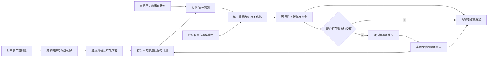

# 电小二产品形态与核心功能决策稿

日期：2026-10-16（Asia/Shanghai）  
用途：产品、算法、后端与前端共同确定产品边界和开发顺序  
状态：研究与建议稿，尚未替团队作出设计决定；本次未改业务代码、未推送、未操作HA或启动比赛。

## 1. 推荐结论：做能理解家庭安排、兑现目标的储能管家

**首选产品形态：面向已有兼容SOLIX储能的德国住宅家庭，提供一个移动端也能方便使用的能源工作台；用户交代目标和未来安排，电小二生成可解释的能源计划，在明确授权及设备条件内持续管理储能，并把执行结果和费用说清楚。**

它由三部分组成：用户使用的网页工作台与助手、持续运行的确定性规划和执行服务、既有SOLIX设备及HA接入。语言模型参与理解和解释，设备动作经过约束检查与反馈核验。

这是一条**推荐的发展方向**，不是当前系统已经具备全部能力的声明。当前代码更接近“家庭数据与计划预览＋独立比赛执行器”；将它变成家庭管家，需要补齐目标契约、用电安排和执行证据之间的连接。

### 1.1 用户应感知到的四件事

1. **我能告诉它家里的安排。**不用只看曲线，也不用学习算法名词。
2. **它按我同意的目标做计划。**我能看清备用电量、费用与运行强度的取舍。
3. **运行状态可以核实。**预览、已授权、实际执行、降级与恢复都有明确区别。
4. **结果能对账，偏好能纠正。**看得到实际费用与证据，不把解释当作已经省下的钱。

### 1.2 首选与备选方向

| 形态 | 能解决什么 | 主要不足或成本 | 本次判断 |
|---|---|---|---|
| **家庭安排驱动的储能管家** | 将用户意图、未来负荷、储能计划、设备执行和结果连起来 | 依赖家庭数据、控制契约、常驻服务及可靠恢复；增量价值待验证 | **首选方向，按阶段交付** |
| 多档位跑分控制台 | 便于工程师比较算法和比赛表现 | 用户还要理解和频繁选择策略；比赛分不能直接回答家庭价值 | 保留为内部工具与比较详情 |
| 只读能源顾问／账本 | 接入风险较低，能解释现状与费用 | 无法自行兑现调度；解释价值是否愿付费未知 | 可作为初始可用阶段，也可服务不宜接管的家庭 |
| 通用语音助手／智能家居平台 | 输入方便，覆盖面广 | 与原生供给重叠，设备范围和支持成本迅速扩大 | 暂缓；先完成储能任务闭环 |

选择首选方向，是因为会议持续追问的不只是档位数量，还包括“用户会不会频繁操作”“未来安排如何进入算法”“失败后能否继续运行”。德国研究则要求接入条件和原生增量可核实。**这两类材料支持这个产品候选，尚未证明它已被德国用户接受。**

### 1.3 首批用户与退出条件

首批工程试点建议限定：已有经核对型号与固件的SOLIX储能、有整户能流数据、合同与计量清楚、愿意授权的家庭。按固定电价和动态合同分别评估；动态合同需要实际签约、相应计量和可用数据，不能由“市场允许提供动态价”推成“本户可套利”。[德国监管说明](https://www.bundesnetzagentur.de/DE/Vportal/Energie/Vertragsarten/DynStromtarife/start.html)

屋顶PV用户可以优先招募来验证余电移时，但不预先认定每户都有大额软件收益。原生已足够、改善上界很小、数据或授权不完整的家庭，可以停留在只读诊断或选择不接管。无电池业主、全部阳台产品、全品牌电池、车和热泵直接控制，暂不纳入首批交付承诺。

相对原生的差异化假设是：**确认并兑现家庭安排，展示计划到执行的偏差及可复核增量。**“会预测、会低买高用、能聊天”本身不构成独有能力；Anker德国当前页面已宣传Anka和AnkerIntelligence相关功能。这只是厂商能力说明，具体用户设备仍需核对，不能反向认定其效果已经实测。[Anker官方页](https://www.ankersolix.com/de/products/a17e2)

## 2. 三份材料究竟说明了什么

### 2.1 读取范围与证据关系

三份材料均属于**2026-10-16 14:00～14:23（GMT+08）同一场“储能产品功能方案讨论”**，不是三场独立讨论或三份用户调研。参与者真实姓名与岗位未可靠确认，以下沿用“说话人1／2／3”，不擅自分配角色。

| 编号 | 材料及版本 | 实际读取范围 | 可靠使用方式 |
|---|---|---|---|
| D1 | [我的笔记：储能产品功能方案讨论 2026年10月16日](https://icnabp01o6e3.feishu.cn/docx/ZQp6d2n2eo8FdZxBtGRcUdAInFg)，revision 3 | 全文534字符 | AI根据笔记与录音生成；仅聚焦备忘录与日志是否有区别 |
| D2 | [智能纪要：储能产品功能方案讨论 2026年10月16日](https://icnabp01o6e3.feishu.cn/docx/HKS3dPVJ7ofSY9x5WndcUltrnkf)，revision 4 | 全文4313字符；另读取档位表、兜底图、演示图及白板缩略图 | 文字与图均标AI生成；可作导航，不能替代逐项共识和实现证据 |
| D3 | [文字记录：储能产品功能方案讨论 2026年10月16日](https://icnabp01o6e3.feishu.cn/docx/DxtDdOmd4oLdA1xMerxcMiHInph)，revision 4 | 返回全文10,822字符、900个逻辑行；最后发言起于21:33，含后续分工安排 | 核对发言和分歧的主要文本；未核听音频，不把转写当原音校对 |
| R | [德国住宅储能市场深度调研与匹配方案](<德国住宅储能市场深度调研与电小二需求—前端—算法匹配方案_20261016.md>) | 已结合全文结构、关键结论和代码证据复读 | 市场事实、研究推断与产品建议分别使用；不是已验证用户偏好 |

D2将用户画像与分工归入21:39章节，D3最后一段发言起于21:33，实际包含相应安排。可以将其记为说话人2提出的后续工作方向；不能进一步推成已执行或全员批准的唯一研发顺序。三份全文和图的本地读取副本保存在项目`.local/产品形态研究_20261016/`，未将整份私有材料复制进公共资料仓库。

### 2.2 可以确认的讨论方向与仍需决定的事项

| 判断层次 | 内容 | 定位 |
|---|---|---|
| 较明确的讨论方向 | SOC用于**备用预留百分比**，拟按5%步进；预留部分之外继续进行经济调度 | D3 00:09、03:23、04:09～04:42 |
| 较明确的讨论方向 | 兜底属于底层逻辑，不应要求用户手动选；规则也不可用时考虑回原生 | D3 19:30～20:08 |
| 可取的产品候选 | 让未来用电安排进入规划；文字或对话只是不同输入方式 | D3 12:21～16:35 |
| 仍有分歧 | 自动运行究竟是独立算法、选择其他策略的按钮，还是与原生混称 | D3 10:35～12:01、18:28～19:07 |
| 定义未完成 | “省钱”“保护电池”“少运行”“足够价差”的含义及门槛 | D3 00:49～00:52、04:51～07:28 |
| 实现自述，未据此验收 | 某成员的程序可令一次失败不挂死后续窗口，逻辑可以提取 | D3 20:54～21:31 |
| 演示与后续工作提案 | 用模拟／离线截图解释策略；研究用户与档位匹配后同步算法、再统一改前端 | D3 07:36～09:12、21:33；是否最终采用及赛事机会规则需另核对 |

### 2.3 逐项解读：哪些值得保留，哪些必须改写

| 讨论主张 | 直接依据 | 分歧、遗漏或推论问题 | 产品影响与建议处理 |
|---|---|---|---|
| ①按百分比备电，5%一步 | [D3 03:23～04:42](https://icnabp01o6e3.feishu.cn/docx/DxtDdOmd4oLdA1xMerxcMiHInph) | 百分比含义比旧研究明确；容量基准、设备字段、合法范围仍未定；“更直观”是团队判断 | 作为独立备用参数，配估算kWh；5%是候选交互步进，不是物理精度或行业标准 |
| ②“全约束最优跑分” | D3 02:48～02:54；08:39～09:04 | 磨损属于成本或约束、PV属于预测输入，不能因此称“全约束”；自定义收益与官方分有区分 | 用户侧改为“综合经济方案”；比赛评分保留独立工作区和口径 |
| ③保护电池、少动搏价差 | D3 00:49～00:52；04:51～07:28 | 与会者自己质疑是否真省钱、为何是一毛；没有可复核标定记录 | 改为可测的“温和运行”：在可接受费用差内减少无效动作／吞吐；不保证延寿 |
| AI是独立开关，选择其他档位 | D3 11:31～12:01、18:28～19:07 | 有赞同也有“不是很好／不知道”；D2把它写得过于确定 | 推荐分清用户目标与自动调度；按钮样式和权限范围仍为建议 |
| 大模型使算法“有了未来” | D3 12:05～15:34 | 现有预测本来就预测未来；新增的是用户事先透露的安排，不是未来真值 | AI提取计划、缺信息时澄清；预测模型估负载，优化器据此重算 |
| 根据上次party知道下次耗电 | D3 13:22、14:38～16:18 | 同期总用电不能直接归因party；活动规模、设备、天气和背景负载可能不同 | 记录时间、设备及实际区间；样本不足时给范围或未知，不造精确耗电 |
| 备忘录等于带记忆日志 | [D1](https://icnabp01o6e3.feishu.cn/docx/ZQp6d2n2eo8FdZxBtGRcUdAInFg)；D3 16:50～17:34 | 底层都能存日志，不代表形成可纠正的偏好、计划或任务结果 | 不把“有备忘录”单列为差异化；用计划采纳、正确回忆和减少重复设置验证价值 |
| AI每分每秒切到最好 | D3 18:44～19:07 | 没有切换收益、驻留、设备延迟和稳定性依据；可能增加动作与损耗 | 新信息触发重规划；目标变化另受授权、切换代价与冷却约束，不承诺逐秒最优 |
| 一次故障只损失5秒，下次成功就接管 | D3 20:08～21:31；D2兜底图 | 程序继续循环不等于设备与经济影响只持续5秒；恢复、读回和新计划有效性未在会议证明 | 展示故障起止、原生确认、再接管条件；“传递成功”不能代替物理确认 |
| 自定义备用无额外约束 | D2的AI档位图 | 转写没有支持；备用本身改变可行域，也受硬件功率和安全条件限制 | 所有目标共用硬约束，不允许某个滑条绕过设备政策 |
| 先前端还是先算法 | D3 09:22、21:33；D2及白板 | 白板同时出现“先框架再算法”与“方案确认后统一改前端”；没有完整一致顺序 | 先确定目标和接口，小规模联调一条流程；视觉可并行，业务语义不能先硬编码 |

所有发言都属于方案讨论。纪要里的“已优化完成”“实现最优”及图中箭头，均不能单独证明代码、设备和收益已经验收。

### 2.4 相比德国研究，需要更新的三个判断

- **SOC不再完全未知。**会议已指向“备用预留比例＋5%步进”。旧研究D1问题可从“它是什么参数”收敛为“这个备用比例的基准、范围、时效和授权怎样定义”。最高SOC或截止时点目标属于其他参数，不再混入这个滑条。
- **自动运行仍未形成完整共识。**旧研究推荐独立自动机制，与部分发言相符，但不能据此写成团队已经批准一个按钮。需确定它到底能重规划、切换策略，还是修改用户目标。
- **未来安排是有价值的候选输入，尚无用户需求验证。**party只是说明机制的例子，不能成为德国核心画像；优先访谈居家、外出、夜间大负载等实际安排发生频率。默认负荷预测应能独立运行，不能要求用户每天填日记。

## 3. 产品结构：目标、备用、计划与权限分别表达

### 3.1 沿用团队编号，但不平铺成一排模式

| 编号 | 在产品中的位置 | 用户看到什么 | 系统应怎样处理 |
|---|---|---|---|
| ①备用百分比 | 家庭目标中的独立约束 | 想保留多少，估算多少kWh，是否已达到 | 与设备底线合成有效政策；改变未来可行计划 |
| ②综合经济 | 可选运行目标 | 尽量降低家庭净费用；预计值与成本假设 | 同时考虑PV、负荷、实际购售电、效率、库存及可信成本 |
| ③温和运行 | 第二个候选目标 | 少做价值不足的动作，以及预计费用取舍 | 在同一硬边界下考虑吞吐、启动／换向、待机与执行代价 |
| ④自动运行 | 管理机制与权限 | 当前在预览还是执行；是否允许目标范围内自动安排 | 重规划、策略比较与用户目标变化分层，LLM无直接功率权 |
| ⑥兜底 | 异常状态 | 降级原因、当前由谁管理、有什么影响 | 只使用输入仍有效且经过验证的确定性规则 |
| ⑦原生自用 | 控制归属／主动退出选项 | 使用设备原生管理，恢复是否确认 | 退出我方、核验原生及租约；失联时保留未知 |

### 3.2 两个目标怎样避免只是改名字

**②综合经济方案**建议优化家庭窗口净成本：购电－售电，加损耗、可校准的边际磨损与执行代价，并统一初末库存口径。PV预测和负荷预测是两个方案都需要的输入，不应只给其中一个档。

**③温和运行方案**需要可量化的不同偏好。例如，在相对②的预计费用差不超过一个可接受范围时，优先减少不值得做的运行段、吞吐和换向。这个范围须由团队用回放与用户权衡确认，不在本文替用户发明“贵5%也可以”的默认值。也可先展示费用—使用强度的候选取舍，由用户选定。

两者都需要硬件保护，也都可以计入可信磨损。不能让②“完全不保护”、③“才有保护”，不能让“省钱档”只减少次数却增加用户无法理解的总费用。参数暂不可靠时展示敏感性，不称已经达到全生命周期最优。

动作的最低财务条件需要完整边际价与效率：网充后供家庭使用时，未来避免的购电价必须覆盖早先购价／往返效率、单位额外成本和运行段固定代价。向网售电须另有资格与可得售电净价。历史平均价差可以辅助生成候选，但不能单独证明有利润。详见德国研究§4.3～4.4。

比赛推荐档仍保留原有官方评分契约，不因②的家庭磨损目标而改名或替换。演示同屏比较时，列清“官方分”“净现金”“库存调整”“估算磨损”，不要生成一个自定义含磨损分数再标为官方分。

### 3.3 一个“AI开关”不足以交代的三种权限

| 层次 | 含义 | MVP建议 |
|---|---|---|
| 是否执行 | 只看计划，还是已授权设备运行 | 预览与执行状态及动作入口清楚分开；当前未贯通时只开放预览 |
| 固定目标内自动计划 | 用户选定目标／备用后，价格、天气或状态变化时重算动作 | **授权执行后的默认能力方向**；不是要求用户逐条批准功率命令 |
| 是否允许改目标或跨策略选择 | 系统能否改变备用、经济／温和偏好和其他边界 | 后续有界授权；MVP先不让LLM自行修改已确认目标 |

因此，选择“温和运行”并不意味着设备每一步都要用户操作；固定目标也能自动滚动规划。AI理解安排、优化器重规划、策略管理器换候选、设备功率更新，是不同动作。不能把它们都包装成“AI换档”。

未来若开放自动选择候选，须满足同一快照、同一用户约束、可信参数、收益改善超过切换代价与裕量、最短驻留条件。冷却时间与触发周期待实测，拒绝逐秒最优承诺。用户改变目标后，旧计划和待处理提案应失效；人工覆盖何时结束必须显示。

### 3.4 备忘录融入任务流程，不新增空泛入口

建议底层区分四类记录：

| 记录 | 例子 | 如何成为有效输入 |
|---|---|---|
| 用户明确偏好 | 平时备用保留某比例 | 由用户确认，标版本／有效期，可编辑撤销 |
| 未来安排 | 明晚来客、周末外出、某设备将在指定时间用电 | 有开始／结束、设备或需求、确定程度；只改变授权范围内计划 |
| 观测与执行事实 | 区间能量、实际SOC、反馈偏差、回退和恢复 | 来源与时间可追溯，缺口不补成真值 |
| 模型解释／待验证推断 | 某活动可能增加负荷，某次损失可能与接管有关 | 标明推断及不确定性，不能自动升级成用户偏好或因果事实 |

用户在“能源计划”里看到未来安排，在“能源账本”里看到运行记录，在设置里编辑已确认偏好。文本表单和助手写入同一结构，不维护两套互相矛盾的备忘录。语音以后可作为同一输入通道，并非先做第二套记忆产品。

类似活动的过去记录可以辅助预测，但需要日期、时长、设备及背景条件；没有分项计量时，只能说“该时段全屋用电”，不能说“party消耗了多少”。样本少时给范围或保留未知。冷启动不要求用户有历史活动标签，平常的负荷／PV预测照常工作。

## 4. 四项核心功能与一条用户流程

### 4.1 核心功能（产品方向；不等于现状）

| 核心功能 | 用户任务 | 主要交互 | 算法／后端输出 | 可验证价值 |
|---|---|---|---|---|
| **1. 家庭目标与备用** | 说明我更在意什么，想留多少电 | 目标选择、5%步进备用候选、请求／有效值与达标状态 | 可行边界、预计取舍、冲突原因 | 用户理解并设成真实可执行目标 |
| **2. 未来用电安排与电小二** | 用自然语言或表单交代未来变化 | 助手提取成计划卡片，确认时间与关键参数，允许修改／删除 | 结构化事件、来源、有效期、负荷情景或明确未知 | 比无安排输入更好地完成任务，少重复设置 |
| **3. 能源计划与有界自动运行** | 看计划，在权限范围内交给系统 | 时间轴、当前执行归属、调整原因、暂停与原生退出 | 版本化计划、可行性检查、设备映射及实际反馈 | 授权边界不被越过，计划能兑现，失败可恢复 |
| **4. 执行与能源账本** | 知道做了什么、花了多少、为什么不同 | 实际费用、库存、预测对照、执行偏差与运行记录 | 同窗账本、数据质量、事件证据、分户结果 | 可核对费用；承认负结果与归因不足 |

首次接入档案是四项能力共同的前置条件，不要求用户每天维护。家庭／合同／计量／型号／固件／回路／原生能力核对完成后，日常只在发生变化或资料过期时更新。

### 4.2 贯穿案例：明晚有客人，希望提前安排

**【虚构交互用例】**某德国住宅家庭已有兼容储能和PV，合同与数据接入已核对。以下不代表已招募用户、设备实测或收益。

| 步骤 | 用户看到／做什么 | 系统必须做什么 | 不满足条件时 |
|---|---|---|---|
| 1. 接入 | 核对当前家庭、设备、合同与计量；知道哪些能力可用 | 读到型号固件、容量功率与数据时钟，确认控制者和原生能力 | 缺项只显示可用能力，不假装已经可执行 |
| 2. 设目标 | 选择温和运行，要求备用保留30% | 30%是本用例中用户的选择，合成设备政策并提示取舍 | 目标低于设备底线或不可达时明确解释，不静默改写 |
| 3. 告诉安排 | “明天18点到22点有客人，帮我提前安排” | 按Europe/Berlin确认日期，提取事件；未知耗电不直接编成3kWh | 可选择仅作提醒；若要改负荷情景，再补关键设备或用电预算 |
| 4. 看计划卡 | 卡片列出安排、保留目标、预计变化、有效期和权限 | 同快照重算；明确新增安排有没有改变计划以及原因 | 数据不足则不宣称“更省”，保留基础预测与缺项 |
| 5. 确认 | 当前版本为“保存安排并预览”；未来执行版显示具体授权范围 | 保存结构化计划与版本；设备写入只能走独立检查链 | 当前代码未贯通时不能出现误导性的“确认接管” |
| 6. 日常运行 | 授权版无需用户频繁换档；可查看近期一次调整 | 新价格／天气／状态触发重规划，保持用户目标；设备动作核验 | 预测失败不停止采集；关键状态缺失走受限兜底或恢复尝试 |
| 7. 看结果 | 查看该时间窗实际费用、能量、执行与原计划差异 | 区分全屋用电、活动估计和可归因结果；反事实另标 | 原生对照或区间能量缺失时，节省留空或标估算 |
| 8. 改或退出 | 取消未来安排、修改目标、暂停或切原生 | 撤销未来效力；重新规划；恢复结果需回读 | 已消耗电量不能撤销；通信中断显示未知与最后确认时间 |

这个例子的价值来自“安排被正确理解并影响可行计划”，不是一句话便精确预测party，也不是展示AI比人更频繁换档。

### 4.3 日常入口与页面关系

保留总览、能源计划、能源账本、策略比较四个页面，主色调和已有视觉方向继续使用：

- **总览：**首先回答“谁在管理、当前目标、数据是否新鲜、接下来一件重要的事”。主入口是添加用电安排／查看计划；仅预览时标题明确写“计划预览”。
- **能源计划：**上方为未来安排和目标，下面是价格、PV／负荷及充放计划；每项调整可解释、可撤销。备忘录的未来部分放这里。
- **能源账本：**呈现特定窗口实际现金、库存和结果，展开才看执行事件与故障。不是把全部运行日志直接丢给用户。
- **策略比较：**作为取舍详情和研究工具，展示同条件方案。工程用的五个内部key不必继续占据用户首页。
- **设置与助手：**设置负责家庭档案、偏好和权限；助手贯穿各页，所有建议返回可核对的卡片，不能只靠聊天文本作为生效凭据。

普通日不要求用户填计划；没有新增安排时仍按已确认目标和基础预测运行。只有影响用户目标、权限或需要处理的异常才主动打扰，避免把每次功率变化变成通知。

## 5. 前端—算法—后端如何共同兑现

### 5.1 关键任务映射

| 用户任务 | 前端交互与状态 | 算法目标和约束 | 所需数据 | 后端执行与确认 | 验收标准 | 当前状态与缺口 |
|---|---|---|---|---|---|---|
| 知道自己能用什么 | 家庭适配清单，已核验／未知／不支持 | 先筛可行动作，不默认网售／离网 | 型号固件、合同、计量、回路、权限 | 有来源的能力档案、部署配置、连接状态 | 不合格能力不可开启；未知不自动当允许 | 有模拟档案；真实家庭能力及合同模板待做 |
| 设置①备用比例 | 5%步进候选，百分比＋估算kWh，请求／有效／当前值 | 有效下限、上限、达标过程，冲突处理 | 可用容量、SOC基准、设备允许值 | 配置原子生效、版本回显；重规划和命令使用同一政策 | 展示与算法／执行一致；非法值拒绝，低于目标不冒充已达标 | 页面有预览；范围及环境契约存在分叉，真实个性化执行未接通 |
| 比较②③ | 同快照费用、吞吐、动作段数和不确定性 | 同一硬约束下不同目标；完整成本及终点 | 价格、PV、负荷、效率、成本区间 | 保存候选条件与参数来源，避免事后挑赢家 | 差异来自明确目标；结果相同也如实显示 | 算法有模式基础；家庭请求会清除磨损／门槛，不能宣传五套独立经济策略 |
| 表达未来安排 | 对话／表单→结构化卡片→确认／撤销 | 经确认事件改变负荷情景或时点要求 | 时间、设备／预算、确定性、有效期 | 事件持久化、冲突检查、家庭隔离、版本 | 歧义先澄清；过期／撤销内容不进入规划 | 有即时助手建议；持续事件与偏好闭环待开发 |
| ④目标内自动计划 | 预览／已授权／运行中，最近重规划原因 | 基础预测与计划输入，保持用户边界 | 当时可用历史、天气、价格和事件 | 常驻服务、计划有效期、校验、租约、反馈 | 模型失效不越权；前端关闭不使后台依赖聊天存活 | 现有比赛后台是受限基础；不是家庭自动换档服务 |
| ⑥故障后继续管理 | 受限兜底、恢复中、原生已确认、未知 | 仅在输入和设备条件有效时用确定规则 | 故障类别、SOC、最近确认状态 | 有界重试、退出、恢复核验、新计划重新准入 | 请求成功、执行成功、恢复确认分别核验 | 有原生回退及mock报告，未证明各种故障只影响5秒 |
| 核对结果 | 预测、实际现金、库存、估算成本和原生增量分列 | 同窗口、初态、信息截止与终点规则 | 区间能量、现金、库存、计划与反馈、对照 | `/api/dashboard`等源经标准化与对账，状态另有证据 | 缺口可见，逐户可复核；未测的模式收益不填 | 有统一快照和累计账本，实际模式节省仍标未测 |
| 让系统记住又能纠正 | 偏好／安排／事实／推断分开，编辑与删除 | 只消费有效且授权的上下文 | 类型、来源、时间、版本和确认 | 持久化、隔离、过期与撤销，数据最小化 | 错误记忆可纠正；不跨家庭调用；解释不自动升级为事实 | 有观测历史，不等于用户对话或偏好长期记忆 |

### 5.2 当前代码的产品边界：具体到入口

本次检查本地frontend `56fb16a5dd43dca093e781beedad7ab7facfacc4`、backend `7ab6dee34da4b52bca9507fc9162f0f9e6c8439d`、algorithm `6022535a4c974c00138c639bc15be562a91290c8`，三仓未修改。未拉远端、未检查运行进程环境或现场设备；源码事实不能当现场事实。

**A. 用户页面与设备执行尚未连接成家庭产品。**`home_workspace.py:101–111`返回`NOT_SENT`、`ha_write_enabled=False`和预览目标；`home_answer`只建议预览。前端助手确认也调用预览并说明未下发动作。将按钮改成“启用”并不会完成控制闭环。[家庭工作台](https://github.com/solix-autopilot/anker-backend/blob/7ab6dee34da4b52bca9507fc9162f0f9e6c8439d/home_workspace.py#L101)、[助手前端](https://github.com/solix-autopilot/anker-frontend/blob/56fb16a5dd43dca093e781beedad7ab7facfacc4/web/assistant-dock.js#L74)

**B. 当前执行器有特定比赛准入。**`scheduled_controller.py:440–442`要求168设备小时、recommend和指定mock档案；`select_action:40–64`还检查v3策略、0%～100%及备用0。个性化家庭备用不能只改参数便认为此入口已经支持。[比赛执行器](https://github.com/solix-autopilot/anker-backend/blob/7ab6dee34da4b52bca9507fc9162f0f9e6c8439d/scheduled_controller.py#L440)

**C. 对前一研究SOC结论作进一步细化：页面声明、政策生成与运行环境仍有实质分叉。**家庭页硬编码至少30%、上限90%的展示和准入；随后把原始reserve交给政策构造，成功时回写生成的政策。`device_parameters`在环境未设置时默认`official_full_range`，导出0／100；`execution_policy`却只在环境变量**显式**等于full range时拒绝家庭strict档案。未设置与显式设置同一默认值可能分支不同。strict还受250W及放电边界限制。因此不能笼统说“当前全系统统一30%～90%”或“已全改0%～100%”。这需要独立配置契约修复与验证，本次不更改。[页面门禁及回写](https://github.com/solix-autopilot/anker-backend/blob/7ab6dee34da4b52bca9507fc9162f0f9e6c8439d/home_workspace.py#L144)、[模拟参数默认](https://github.com/solix-autopilot/anker-backend/blob/7ab6dee34da4b52bca9507fc9162f0f9e6c8439d/device_parameters.py#L13)、[政策构造](https://github.com/solix-autopilot/anker-backend/blob/7ab6dee34da4b52bca9507fc9162f0f9e6c8439d/execution_policy.py#L14)

**D. ②③尚未按家庭页面名称完整生效。**`official_workspace.make_input`显式请求`energy_cash_without_wear`，算法口径解析将磨损和价差门槛清零。模式模块有不同默认值，也已实现币种换算，但不能据此说家庭页面已在按磨损和少动作成本运行。五档可能因目标口径和有效备用相同而产生相同计划，不能为了截图伪造差异。[请求构造](https://github.com/solix-autopilot/anker-backend/blob/7ab6dee34da4b52bca9507fc9162f0f9e6c8439d/official_workspace.py#L80)、[口径解析](https://github.com/solix-autopilot/anker-algorithm/blob/6022535a4c974c00138c639bc15be562a91290c8/api_service.py#L121)

**E. “auto”标签与用户记忆不代表自学习已经完成。**算法`autotune`明示未实现；家庭auto预览只是以当前负载估两小时备用量。家庭助手每次输入当前快照与本次问题，未接入持久的多轮／偏好历史。已有HA观测历史可供预测，它和用户授权记忆是不同能力。[autotune](https://github.com/solix-autopilot/anker-algorithm/blob/6022535a4c974c00138c639bc15be562a91290c8/core/src/autopilot/modes/auto/autotune.py#L35)、[助手上下文](https://github.com/solix-autopilot/anker-backend/blob/7ab6dee34da4b52bca9507fc9162f0f9e6c8439d/home_workspace.py#L269)

**F. “仅影响5秒”不能成为产品保证。**代码中的5秒是×180比赛的调度周期，约对应15设备分钟；反馈等待另设15真实秒，恢复、执行延迟与SOC都会影响后续。代码支持循环有界处理与恢复尝试，但点反馈自身也标明不是区间能量跟踪。若某时段中断，后续计划须按实际状态重规划，而不是接着执行旧轨迹。[周期与反馈等待](https://github.com/solix-autopilot/anker-backend/blob/7ab6dee34da4b52bca9507fc9162f0f9e6c8439d/scheduled_controller.py#L22)、[恢复与反馈](https://github.com/solix-autopilot/anker-backend/blob/7ab6dee34da4b52bca9507fc9162f0f9e6c8439d/scheduled_controller.py#L200)

**G. `/api/dashboard`是数据源，不是全部产品状态或AI贡献证明。**现有经济快照取该响应的遥测、原生基线和累计费用／库存并对账，价格天气另取；家庭预测增强还可能使用较新的HA状态，而执行卡来自运行记录。这些时钟和范围不能默认一致。当前家庭账本明确将所选模式实际节省标为`not_measured`。[经济源读取](https://github.com/solix-autopilot/anker-backend/blob/7ab6dee34da4b52bca9507fc9162f0f9e6c8439d/official_economics.py#L259)、[家庭账本](https://github.com/solix-autopilot/anker-backend/blob/7ab6dee34da4b52bca9507fc9162f0f9e6c8439d/home_workspace.py#L94)

10/15留存报告已经支持一场完整官方mock执行与恢复、合计正增益且第三户为负；本次只核读相关材料，没有复跑。这一基础应保留，不应把“首次完整跑通”又列成未完成；也不能扩大为任意家庭目标、全部区间跟踪或德国长期收益已通过。[留存验收报告](https://github.com/solix-autopilot/anker-backend/blob/7ab6dee34da4b52bca9507fc9162f0f9e6c8439d/docs/20261015_零动作与功率反馈官方整场验收.md)

### 5.3 信息怎样流动

图中“结果进入记录”不代表模型自动将它提升为事实偏好。语言模型只在理解安排、澄清和解释时使用，不必每个控制周期调用；其失效不应阻止已授权的确定性规则、基础采集和账本继续工作。

**未来安排如何进入预测，先做最小且可测的一种。**事件包含开始／结束、设备或明确预算、强弱约束、来源和有效期。已确认事件可作为基线负荷的情景修正；经常发生且已被基线学到的活动，应替换或调整对应部分，不能把整段耗电再加一次。用户只说“有客人”、没有可用量化依据时，保存事件并给范围或待补信息，不能让LLM随口给出精确kW曲线。

事件影响是否有价值，先以不含事件输入的现有预测为对照；使用留出窗口，分别看预测误差、目标满足、净费用与执行偏差。日志多、LLM回答顺畅不能替代这一对照。

### 5.4 运行和部署形态

界面建议先用现有网页做移动端适配，暂不增加独立原生App。调度与采集需要运行在能可靠访问HA的常驻环境；网页关闭不应成为停止后台的唯一条件。采用云托管界面时，仍要有明确受限的家庭本地连接方案，不能假定Launch等云环境能直接访问家庭局域网。

Anker官方集成描述了本地Modbus TCP接入，这是技术入口而非所有家庭已经可用的证明。本次HA指南页面重读超时，改核对官方集成仓库；具体型号固件、部署方式和接口条件仍须逐户验证。[官方集成](https://github.com/anker-charging/ha-anker-solix-official)

后端保管模型及HA凭据，前端展示状态和授权；控制执行与可选LLM解释保持分离。最初可以复用已有HA主机或常开环境，但接入、资源及运维负担都要计入交付成本。本文不新建连接通道或改变现有网络配置。

### 5.5 故障与再接管的产品契约

| 状态 | 后端原则 | 用户应看到什么 |
|---|---|---|
| 正常计划为零 | 使用明确零动作语义，不等于已回原生 | 正常待机及原因 |
| 预测或LLM失败，设备数据有效 | 采集继续，判断是否有合格受限规则 | 输入不可用、当前策略来自哪条规则 |
| 关键状态失效或计划不可行 | 不继续盲目用旧计划；尝试退出与恢复 | 运行受限／恢复中及目标影响 |
| 恢复命令已发，尚未核实 | 有界回读，保留未确认 | 不显示“已恢复” |
| 通信中断 | 依照经验证的本地超时行为处理，不能承诺远程成功 | 状态未知、最近确认时间和处理入口 |
| 恢复原生已确认 | 记录模式、时钟、租约／控制归属证据 | 当前由原生管理 |
| 准备重新接管 | 新鲜状态、新计划、有效授权和控制权均满足才重新准入 | 已满足后再显示重新运行；不是“收到一次200即接管” |

恢复和再接管是不同流程。用户主动暂停后的恢复，不能由一次网络恢复擅自重新开启；故障引起的临时降级是否允许自动重接管，要在授权中说明。

## 6. 最小交付范围与开发顺序

### 6.1 当前、演示与家庭运行三个范围

| 范围 | 可以交付／展示什么 | 不能混称什么 |
|---|---|---|
| 已有代码与留存演示基础（当前部署可用性未核验） | 数据概览、家庭计划预览、当前上下文解释、官方账本、独立执行记录；用现有证据讲解 | 页面选档不等于设备已切换；累计成绩不等于所选档位贡献 |
| 下一版最小产品流程 | 一套明确的目标／备用语义＋结构化未来安排＋同条件计划比较＋结果证据；先影子运行 | 未来安排能力若是新开发，需标新版本；不能借用旧控制场次证明 |
| 授权家庭执行版 | 在一种已验型号／合同／部署条件下，固定目标内滚动规划、设备反馈、原生退出与结果核对 | 不扩展成全品牌、整屋备电、无限自动换目标或全年收益保证 |

建议最初固定用户目标；自动重规划优先于自动修改目标。待基础证据和用户权限研究充分，再开放小候选集合中的有界策略选择。

### 6.2 最先做的三项工作

| 顺序 | 工作包与责任 | 具体范围 | 依赖与完成标准 |
|---|---|---|---|
| **1** | **统一目标与执行契约**：产品、算法、后端联合，前端消费 | 明确①备用比例；②③成本与取舍；区分比赛／家庭档案；修复页面、环境默认和执行政策分叉 | 同一目标版本贯穿预览、规划、执行、恢复；环境缺省与显式默认等价；不允许静默放宽边界。未接通真实执行时UI仍标预览 |
| **2** | **完成“安排→计划卡→重规划”**：产品／前端／后端／算法 | 一个表单和助手入口，共用事件结构；确认、有效期、撤销；先采用明确可量化预算或保留未知 | 时间与家庭隔离正确；重启后记录仍在；取消和过期不再影响计划；与无事件基线比较并记录结果 |
| **3** | **完成“计划→执行→账本”证据串联**：后端主责，算法、前端配合 | 复用现有经济快照和审计；联结目标版本、计划、指令、反馈、费用及恢复；逐户显示负结果 | 同窗口和时钟核对；点反馈与区间能量分开；未测归因留空；预览、离线、mock、实体范围不能互相替代 |

为什么这样排：第一项避免产品承诺与执行相互矛盾；第二项形成会议最有潜力的新用户任务；第三项证明它有没有产生实际价值。视觉设计可同步探索，但不应先把未定权限、成本或状态写死进界面。

### 6.3 保留、调整、新增与暂缓

| 处理 | 内容 | 原因 |
|---|---|---|
| 保留 | 四页工作台、三语、已有模型和规划、统一经济快照、采集解耦、后台执行及恢复基础 | 与主线一致，避免重造已经完成的工程 |
| 调整 | “最佳跑分”用户文案、五档同级呈现、①参数含义、自动运行语义、费用口径、5秒故障保证 | 现有讨论／实现不能支持这些宽泛承诺 |
| 新增 | 有来源的家庭档案、确认后的未来安排、目标版本、事件与执行账本关联、记忆可纠正 | 支撑家庭管家的具体任务，而非单纯多一个按钮 |
| 暂缓 | 任意LLM功率指令、每秒换目标、无依据估party用电、全设备控制、直接EV／热泵控制、独立语音系统 | 缺少需求、数据、授权及设备验证，扩大接入和运维负担 |
| 不预设必须有 | 第三个用户目标、单独备忘录主菜单、额外实体网关、统一订阅价 | 由访谈、部署与价值验证决定，不为页面丰富度添加 |

### 6.4 比赛演示怎么讲，才与产品一致

推荐演示一条任务链：**说明家庭条件→设定目标与备用→添加未来安排→看计划变化→看执行证据→核对结果与恢复。**这比截五个档位的分数更能说明产品形态。

现有真实记录、离线回放、影子计算和新交互原型分别标明。展示②③的取舍时，可使用同一输入下的回放，并列原生、经济、温和方案；没有独立运行结果时不要伪装成已经逐档实跑。同一场累计分不能因用户点击某个预览按钮就归到该档。

可以解释含磨损的家庭评价，但不把它标为官方评分；可以用已有完整mock讲执行基础，但不能用它证明新事件记忆或新目标机制已经有效。本次不占用任何正式赛或mock机会，也不据会议中的“一次机会”口头说法确认当前赛事规则。

### 6.5 验证最小集合

| 要验证的承诺 | 至少检查什么 | 不通过时 |
|---|---|---|
| 正确理解安排 | 明天／跨日／Europe/Berlin夏令时，歧义、修改、取消、多个家庭及同一家庭多人冲突 | 澄清或保留未确认，不进入执行 |
| 记忆可用又可纠正 | 偏好／事实／推断区分，重启、有效期、旧提案、撤销、家庭切换 | 拒绝旧版本，展示来源，不让错误变永久规则 |
| 目标真实生效 | SOC范围、下限高于当前电量、上限、空可行域、预算与备用冲突、固定价／动态条件 | 显示未达或不可行，不伪造达标 |
| 自动仍受控制 | 固定目标重规划、目标更改权限、LLM失败、手动暂停、故障临时降级再接管 | 保持授权范围，用户暂停不能被网络恢复覆盖 |
| 执行失败可管理 | 过期计划、延迟、命令拒绝、功率反馈不符、断网、恢复回读缺失 | 降级／退出／未知状态准确，保留时间缺口 |
| 用户价值成立 | 同信息截止、同约束、同初末库存的原生／简单规则／新方案；逐户实际费用、吞吐、目标与偏差 | 记录负结果；价值太小可不接管，不靠新模型掩盖 |
| 界面能被理解 | 德语长标签／移动端；用户自行分清“预览、运行、已结算、估算”，完成撤销和退出任务 | 优先修高影响误解；翻译键存在不等于本地化通过 |

探索性用户样本用于发现误解与任务，不报告德国总体偏好比例。跨季节数据、实体设备、实际付款及长期支持成本，仍属于赛后商业验证；一次回放或mock不能替代。

## 7. 团队下一轮需要决定的六件事

### 7.1 具体决定、取舍与建议

| 决定 | 当前已知与未知 | 可选方案与取舍 | 本次建议／需要补证 |
|---|---|---|---|
| **D1 备用比例的正式定义** | 已知会议选备用百分比及5%步进；容量基准、额外保留或总SOC下限、可调范围和时效未定 | 总SOC下限便于对齐设备；额外保留能量更接近应急语义但换算复杂 | 首版优先对齐设备可验证字段，文案说明基准；产品与算法明确字段后再测用户理解。不得将5%步进当精度 |
| **D2 ②③是否都值得用户选择** | 有两种目标设想，无真实用户权衡、无已核验磨损标定 | 只保留综合经济更简单；保留温和目标能表达使用代价但需费用取舍 | 两种方案先做同条件候选比较；用户能理解且存在可感知差异后再决定是否长期保留两个入口 |
| **D3 首批家庭与部署条件** | 有兼容设备研究和比赛基础，无成套真实德国用户资料 | 屋顶PV固定价易核对；动态已开通有更多机会但合同复杂；阳台需独立适配 | 限一种设备配置，固定／动态各看合格条件；按实际招募决定，不把市场存量当用户名单 |
| **D4 自动到底可改什么** | 会议对按钮／算法仍有分歧 | 固定目标内重规划可控；跨目标选择更省操作但会改变偏好与风险 | 首版固定目标内自动安排；提高备用、改目标、网充等分别定义权限。用户暂停与故障恢复分开 |
| **D5 未来安排第一种数据形态** | party耗电未知；输入方式可以共用底座 | 用户明确预算可测但需输入；历史活动推断方便但难归因 | 先结构化时间与明确参数，缺量保留未知；用“事件有没有改善任务”验证，再扩展历史活动推断 |
| **D6 当前演示与研发范围** | 转写和纪要包含不同顺序与截图提案，尚未形成可验收范围 | 先视觉能快出效果；先接口语义能减少返工；两者可以局部并行 | 先锁定一条任务、字段和状态，做最小联调；视觉并行但不抢先承诺控制；正式规则另以主办方最新资料核对 |

这些是产品决定，不是本次需要用户额外批准的设备操作。本次交付到文档，不替团队确认尚未形成的共识。

### 7.2 紧接着应怎样向真实用户验证

从德国研究已有访谈提纲中，先选最能决定形态的五个任务，不先展示“AI换档”以诱导认同：

1. **最近一次不满意的能源管理经历是什么？**请展示原生App里当时怎样处理。判断痛点是调度、解释、接入、备电还是根本没有问题。
2. **下一周有什么已知用电变化，现在怎样安排？**记录发生频率与是否愿意主动输入，允许结论是“不想填计划”。
3. **“保留30%”在用户心中是什么意思？**先听理解，再让其完成设定和撤销；不能预设百分比一定比时间直观。
4. **面对两份有明确费用与运行强度差异的方案，会怎样选？**不暗示少循环必然更好，也不制造无依据的收益数字。
5. **哪些事情愿意一次授权，哪些必须通知或重新确认？**分别问重规划、网充、改备用、改目标、故障后再接管，而非只问是否信任AI。

每次区分原话、展示行为、任务完成与实际支付；保留反例。若用户只需要一次设置、现有原生已足够，计划管家的核心假设就需要收窄。若主要愿为排障或账本付费，可保留只读产品形态，不能为了守住“AI自动化”硬加控制。

## 8. 证据索引与交付边界

### 8.1 本次读到了什么、没有读到什么

- 三份飞书文档分别读取其当前返回正文，revision分别3／4／4；D2的三图和白板已读取。图与纪要是AI整理，非新增独立证据。
- 没有核听音频，没有确认说话人真实身份；D3最后一段从21:33开始并已读到后续工作安排。D2与D3的章节时间不同，不据此补造说话人或全员批准记录。
- 已结合前一份德国研究；本次重点是产品收敛，**不是重新开展全量市场统计或法规审计**。旧报告的SAM、支付、长期收益及实体设备缺口继续保留。
- 当前关键代码静态核查及提交见§5.2。未跑新测试、未调用现场HA／dashboard、未检查正在运行的配置，因此没有新运行验收结果。
- 本次重读德国动态电价监管页、Max AC商品页及官方HA集成仓库；HA指南网页读取超时，未绕过权限或据失败结果补造内容。

### 8.2 材料如何相互支持

| 证据 | 在本稿中的用途 | 不能替代的证据 |
|---|---|---|
| [D1个人AI笔记](https://icnabp01o6e3.feishu.cn/docx/ZQp6d2n2eo8FdZxBtGRcUdAInFg) | 定位备忘录／日志争议 | 独立访谈、研发完成 |
| [D2智能纪要与图](https://icnabp01o6e3.feishu.cn/docx/HKS3dPVJ7ofSY9x5WndcUltrnkf) | 提炼候选、发现摘要与转写差异 | 团队一致决议、设备效果 |
| [D3文字记录](https://icnabp01o6e3.feishu.cn/docx/DxtDdOmd4oLdA1xMerxcMiHInph) | 时间戳发言和分歧，见§2.3 | 原音校对、已批准的实施计划、用户需求成立 |
| [R德国研究](<德国住宅储能市场深度调研与电小二需求—前端—算法匹配方案_20261016.md>) | 用户候选、经济／合同／硬件边界、访谈问题 | 已招募用户、实际支付、所有法规则完整判定 |
| [决赛评估](<20261015_电小二决赛评分逐项评估与深化任务(2).md>)及后端留存报告 | 比赛主线、完整mock基础和剩余损失 | 德国实体设备、家庭个性化执行、机制独立增量 |
| [BNetzA动态合同](https://www.bundesnetzagentur.de/DE/Vportal/Energie/Vertragsarten/DynStromtarife/start.html) | 本次复核iMSys与合同接入条件 | 某户已开通、具体零售套利收益 |
| [Max AC官方页](https://www.ankersolix.com/de/products/a17e2) | 本次复核原生供给及型号边界 | 原生实测改善、所有固件能力、比赛5kW可直接用于家庭 |
| [官方HA集成仓库](https://github.com/anker-charging/ha-anker-solix-official) | 本次复核本地技术接入路径 | 常驻服务交付、网络可达、许可外的设备能力 |

直接网页读取日期均为2026-10-16；未标发布日期的页面按当日页面引用。具体法规及硬件扩展范围仍参照R的来源与未完成核验项；本稿不扩大这些结论。

本地资料根目录：`/Users/molin/Documents/ChatGPT/anker_project/local-preview/github-review-20261007/`。原始读取副本位于`/Users/molin/Documents/ChatGPT/anker_project/local-preview/.local/产品形态研究_20261016/`。完整来源响应与正文分开保留，便于以后核对版本，不将私有全文作为公共附件发布。

### 8.3 本稿形成的决定建议

**建议把电小二做成“以家庭目标和未来安排为输入、具有执行和费用证据的储能管家”。用户面对四项任务：设目标、交代安排、看计划运行、核对结果；备用是参数，自动是管理机制，兜底是系统状态。**

下一步先统一目标契约，再完成一条安排到计划的流程，并将其与执行和账本关联。团队先定备用的正式语义、自动权限及首个可交付家庭范围；这些决定形成后，才能把本稿转成具体页面和开发任务。
